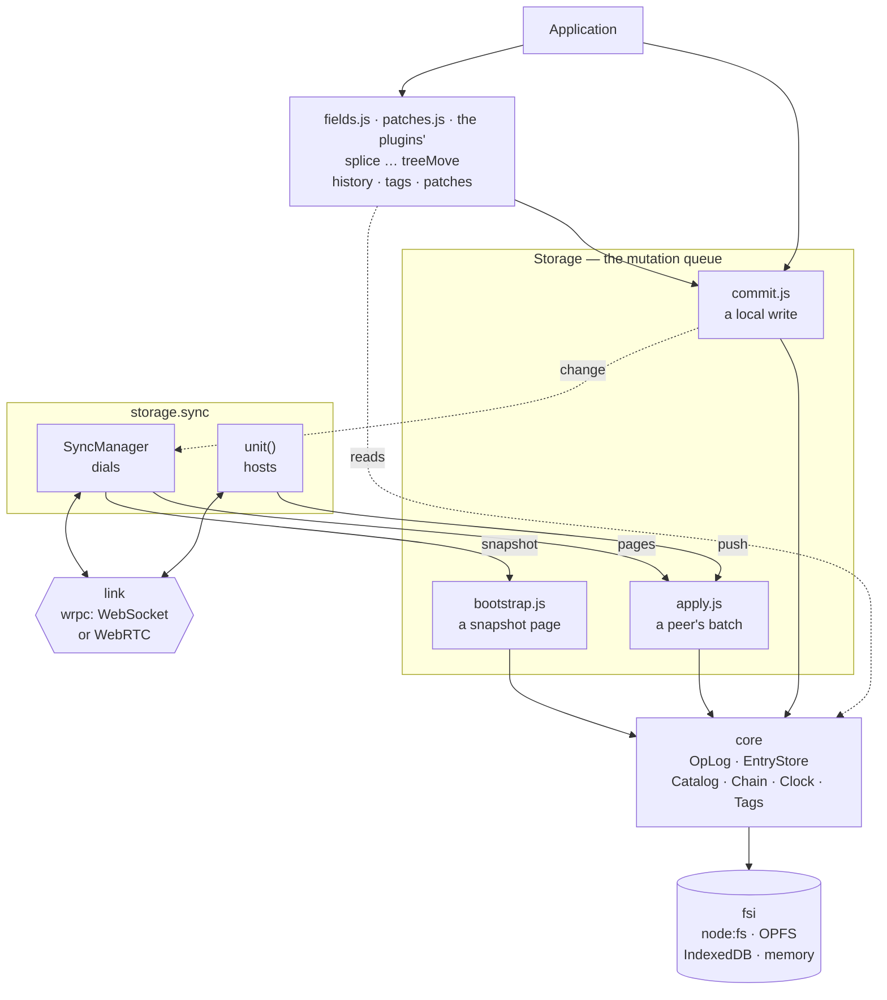
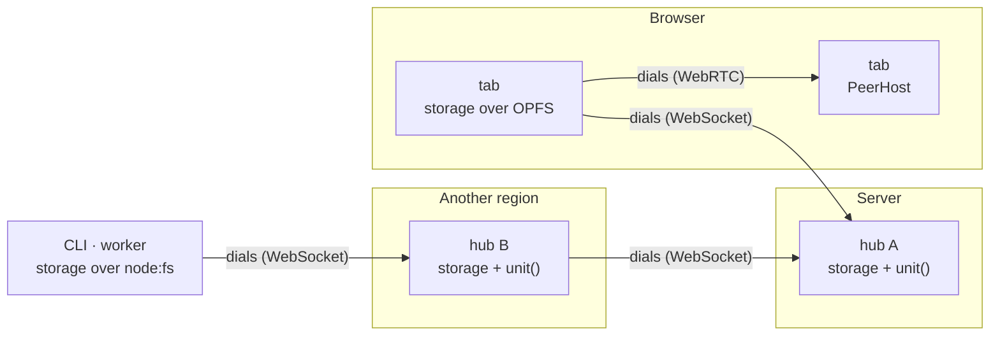
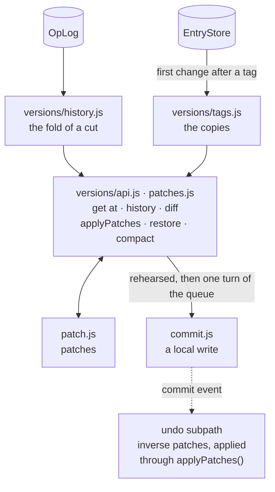

# Architecture

This page shows how syncom is put together: what a storage is made of, the three paths a write
can take into it, how two nodes replicate, how the past is read back, and what lies on disk.
Each part has a guide of its own; this page is the map between them.

## The big picture

A `Storage` is the facade an application opens. It owns the **mutation queue**: every write runs
inside it, one at a time. It lends its collaborators (the log, the clock, the chain, the
records, the tags) as one `core` to the three write paths, to the API modules behind its
methods — `src/fields.js` for the field kinds beyond registers, `src/patches.js` for the present's
patches — and to the plugins' (`src/versions/api.js`, a kind's methods), and to nothing else; the
facade keeps one delegate or stub per method.
`storage.sync` is the replication — the `sync` plugin: the dialing side (`SyncManager`) and the
hosting side (`unit()`). Everything that touches the outside world is injected: the backend (`fsi`), the
transport (a link), the validator, the text index, the telemetry.



- **Three write paths, one core.** A local write goes through `src/commit.js`, a peer's page
  through `src/apply.js`, a snapshot page through `src/bootstrap.js`. All three run inside the
  queue, all three end in the same `EntryStore.write`, and there is no fourth: a `splice()`, a
  `restore()` or an undo is a local write like `update()`.
- **Log first, then data.** An op is appended to the log before its record is written, so a
  crash between the two is replayed on the next open. The chain and the catalog are derived
  from what was written.
- **Events never run inside a write.** Hooks do: they can change or refuse the operation.
  Events (`change`, `commit`, `apply`, `sync`, …) leave after it, and a listener that throws
  cannot break anything. See [Hooks and events](/guide/hooks).

## A local write

`storage.update(id, { done: true })`, step by step. An insert, an increment, an add to a set, a
splice, a mark, a tree move, a delete or a purge take the same road with another op type.

```mermaid
sequenceDiagram
  autonumber
  participant A as application
  participant Q as mutation queue
  participant C as commit.js
  participant L as OpLog
  participant B as Blockchain
  participant E as EntryStore + Catalog
  participant S as SyncManager
  A->>Q: update(id, { done: true })
  Q->>C: run when the queue reaches it
  C->>C: beforeWrite hook · kind check · stamp from the clock · index resolved · applyOp
  C->>C: validator (folded into the op) · unique keys
  C->>C: sign the op (Ed25519) — unless signatures: false; on the thread pool when writes queue behind
  C->>L: append(op) — the seq reserved, the entry in flight; the queue moves on
  L->>L: the group's file — every op appended meanwhile — written; the ticket resolves
  C->>B: addBlock(hash of the record) — unless chain: false
  C->>E: write the record file, put its catalog row
  C->>L: applied(seq)
  C->>C: afterWrite hook · refresh live Records · commit event
  C-->>S: change(op)
  S->>S: push to every peer, in order
  C-->>A: resolves
```

The field's kind is checked before anything is stamped (`FIELD_KIND`), and an index, a sibling
or a range is resolved inside the queue, against the record as it is (`OUT_OF_RANGE`, `CYCLE`,
`NOT_FOUND`). A write that changes nothing stops after `applyOp` and appends nothing; a tree
move to where the node is stops before it. A record written with `encrypted: true` is sealed for
this node's key and produces no op. The mutation queue holds a write up to the append (step 6):
from there the next write runs, building on the entry in flight, while the disk is waited for
outside the queue; steps 7 to 12 come in log order once the op's group is on disk, and that is
what the caller awaits. The catalog file is saved off the queue, so a write never
waits for it. Under `open({ defer })` — 16 ms by default — steps 8 to 10 wait for a timer instead: the log is durable
at once, the cache and the catalog read the entry meanwhile, and the writes of one record within
the window land as one file, every record due under one block; `flush()` lands them now.

## Two nodes

Every node can do both: dial a host and serve its own unit. A dialer says hello, pushes what the
host lacks, and subscribes to the host's feed from the last event id it saw. From then on, ops
flow both ways and every node relays what it applies to its other peers.



- **Resume, or bootstrap.** A dialer that comes back resumes from its cursor, which wrpc's
  subscriptions keep. One that has been away longer than the host keeps its log, or a new one,
  receives a streamed snapshot instead and joins each page of it as one batch. See
  [Sync](/guide/sync#bootstrap).
- **The host enforces.** `push` drops the ops outside the peer's scopes before applying the
  rest. `changes` and `snapshot` serve only the scopes `grant()` allows. Every op's signature is
  verified against its origin — the node id is the key — and every op is checked for shape and
  clock skew before anything reads it. See [Signatures](/guide/sync#signatures), and
  [Scaling](/guide/scaling) for hubs that dial each other.
- **Reconnects belong to the link.** syncom runs no reconnect loop or timer of its own. A failed
  push marks the peer as behind, and the next sign of life on the link sends what is missing.

The handshake, message by message, is on the [Sync](/guide/sync) page.

## Convergence

An op is applied by `applyOp` in `src/ops.js`, the same function on every node:

- a **field** is a last-writer-wins register, ordered by `(ts, origin)`; `ts` comes from a clock
  that never falls behind a stamp the node has seen;
- a **counter** is a sum per origin, so concurrent increments add up;
- a **set** keeps, per element and origin, the newest add and the newest add a remove had
  observed, so concurrent adds both keep and an add a remove did not see survives it;
- a **list** or a **text** is a tree of runs (Fugue): an element's place is the right child of
  the one before it or the left child of the leftmost descendant of its first right child, so
  concurrent inserts at one spot both keep and each writer's run stays whole; a deleted element
  keeps its place, and a list's elements carry a position and a value register, a text's marks
  two anchors each (see [Lists, text and trees](/guide/lists));
- a **tree** is the fold of every node's moves in stamp order, a move that would put a node
  under itself skipped (Kleppmann et al., 2021), so two nodes agree on which concurrent move
  lost; siblings order by a fractional index, then by stamp;
- a field two nodes make as **different kinds** at once ends as one kind everywhere, by the
  kinds alone: a register outranks a counter, a counter a set, a set a list, a list a text, a
  text a tree — on the op path as in a snapshot merge;
- a **delete** is a tombstone that a newer write revives; a **purge** wins at any stamp and
  scrubs the id from the log and from every tag;
- ops from one origin apply in sequence order; a duplicate or a gap is skipped, and resuming
  from the last event id fills the gap.

Any order, any number of times, gives the same record. What a peer can make a node hold is
bounded the same way on the op path and in a snapshot: slots per run and per field, pending work
per field (`sync.pendingMax`), the length of a tree place and the depth a tree reads; past a
bound an op is refused, not half applied. See
[Registers, counters, sets, lists and text](/guide/sync#registers-counters-sets-lists-and-text)
and [Costs and limits](/guide/lists#costs-and-limits).

## Versions

The past is read out of the log, and every way back to it is new ops through the local write
path — nothing rewrites the log or a record file.



- **A version is a fold.** `get(id, { at })` and `history(id)` take the log's entries of the
  record up to a cut — an event id, a stamp or a vector — and fold them with the same `applyOp`.
  The fold is exact while the log holds everything the record depends on: nothing dropped
  (`droppedTs` 0), or a reset stamped above what was dropped; otherwise `get()` rejects with
  `HISTORY_GONE` and `history()` says `exact: false`.
- **A tag is copy-on-write at the `EntryStore` seam.** Before a record's first change after the
  newest tag, its file is copied into that tag; a tag's own catalog says what existed then.
  Tags stay on the node.
- **Patches are the write API's terms.** `diff()` hands out `put`, `write`, `inc`, `add`,
  `remove`, `splice`, `treeMove`… per field by kind; `applyPatches()` rehearses them over a
  scratch record, then commits them in one turn of the queue, so a `restore()` lands whole or
  not at all. `compact(id)` is the reading rewritten as a reset plus one op per field.
- **Undo and branches are subpaths over the public API.** `@alexify/syncom/undo` keeps the
  inverse patches of every `commit` event and applies them with `applyPatches()`;
  `@alexify/syncom/branch` opens a fork through the parent's constructor — another storage
  with its own identity — and merges either way as the ops one side lacks, picked by
  `src/sync/outbound.js` as a push picks them, through `applyRemote()`.

See [Versions and history](/guide/versions).

## On disk

A storage is one directory, through whichever `fsi` it was given:

```
data/
├── node.json      this node's identity: its signing key with the signing plugin, else what getId minted
├── keys/          two key pairs when their plugins run: RSA (encryption at rest), Ed25519 (signing ops)
├── blockchain/    one block per write, and the tail (unless chain: false)
├── lock.json      while an instance holds the directory
├── schema.json    the schema version this directory last ran
├── index/         catalog.json — derived (ids, indexes, search text), rebuilt when missing
├── data/          <id>.json per record: data, meta, the block that committed it; a large text's runs in pieces beside it
├── log/           the operation log: open files and sealed segments
├── tags.json      the tags taken here, once there is one
├── tags/          per tag: its catalog, and the record files copied before their first change
├── branch.json    the parent and the fork point, in a branch's directory
└── remote/        one file per registered sync node
```

[Storage](/guide/storage#on-disk) explains each file, and [Backends](/guide/backends) explains
the five functions an `fsi` implements.

## The modules

| Module | Role |
| --- | --- |
| `storage.js` | The facade: the open sequence, the mutation queue, the public API (a delegate per method of the two API modules), the `core` it lends |
| `plugin.js` | The registry one `open({ plugins })` builds: kind modules and API modules, per storage, never process-wide; `PLUGIN_MISSING` |
| `fields.js`, `patches.js`, `versions/versions.js`, `versions/api.js` | The API of the core's kinds beyond registers (`inc`, `add`, `remove`); the present's patches (`applyPatches`, `compact`); the `@alexify/syncom/versions` plugin and its API (`get(id, { at })`, `history`, `diff`, `restore`, `tag`, `untag`, `at`), over the lent core; a plugin's methods come with the plugin |
| `commit.js`, `apply.js`, `bootstrap.js` | The three write paths |
| `args.js`, `shape.js`, `options.js` | The checks at the edges: the write API's arguments (shared with the patches), record ids and a peer's op shape, `open()`'s options |
| `entries.js`, `catalog.js`, `record.js` | Record files, the bounded cache, the catalog (ids, indexes, tombstones); `Record`, `Reference` and `Collection` |
| `log.js`, `sync/outbound.js` | `OpLog`, the persisted operation log: append, seal, retention, scrub, pins; the ops a receiver lacks, for a push and a branch merge |
| `ops.js`, `vector.js` | The op model (`applyOp` over registers, counters, sets and one `blocks` slot per plugin kind; the kinds' precedence by the registry's ranks), clocks and version vectors |
| `text/text.js`, `text/sequence.js`, `text/btree.js`, `text/pmap.js`, `text/plist.js`, `text/rle.js`, `text/myers.js` | The `@alexify/syncom/text` plugin: lists and texts — Fugue runs placed by a walk into a persistent rope (a B+-tree with two measures, path-copied per op, a text cache per node), the run records in a persistent map, a placed run's segments and children in chunked lists; a movable list's registers, marks, cursors; the run-length content of a run; the Myers diff behind `updateText()` and the splices of a patch |
| `tree/tree.js`, `tree/moves.js`, `order/order.js` | The `@alexify/syncom/tree` plugin: every node's moves and their fold, kept by the block and handed on to the block an op makes (an older move landed by undo–do–redo, the reading path-copied); fractional indexes for a node's place and the `@alexify/syncom/order` subpath |
| `all/all.js` | The `@alexify/syncom/all` entry: the core with every shipped plugin registered |
| `versions/history.js`, `versions/tags.js`, `patch.js` | A version as a fold of the log; tags as copy-on-write record files (the versions plugin's); the patch vocabulary of `diff()` and `applyPatches()`, a plugin's kinds through the registry |
| `undo/undo.js`, `branch/branch.js` | The `@alexify/syncom/undo` and `@alexify/syncom/branch` subpaths — over the public API, no engine bundled |
| `chain/chain.js`, `contracts/contracts.js`, `crdt.js` | The hash-linked chain, a plugin (`@alexify/syncom/chain`); the `@alexify/syncom/contracts` subpath; `diff`/`merge`/`apply` over plain objects |
| `schema/schema.js`, `schema/define.js`, `schema/lens.js`, `schema/entity.js` | The `@alexify/syncom/schema` plugin: validators, versions and lenses read once; the record as its validator sees it (the core's) |
| `query/query.js`, `query/cursor.js` | The `@alexify/syncom/query` plugin: Mango cursors, `$text` among them |
| `search/search.js` | The `@alexify/syncom/search` subpath: the trigram index behind `$text` — the core knows only its contract |
| `signing/signing.js`, `signing/sign.js`, `signing/ed25519.js`, `crypto/keys.js`, `crypto/pem.js`, `header.js`, `crypto/digest.js` | The identity plugin (`@alexify/syncom/signing`); signing an op and verifying it; the Ed25519 half; the key pairs on disk and their PEM (shared with the encryption plugin); what names an op — its header, its payload's digest, its fingerprint, the core's whether a node signs or not; the core's SHA-256 (node:crypto, Web Crypto in the browser) |
| `encryption/encryption.js`, `encryption/rsa.js` | The sealing plugin and the at-rest backend wrapper (`@alexify/syncom/encryption`); the RSA half |
| `sync/sync.js`, `sync/manager.js`, `sync/hosting.js`, `sync/outbound.js`, `sync/link.js`, `sync/wire.js`, `sync/protocol.js`, `wrpc/wrpc.js`, `scope.js` | The sync plugin (`@alexify/syncom/sync`): dialing and hosting; the selection a push makes (the core's updates API); the link contract, the ops as they cross, the wrpc adapter, what both halves agree on, what "in scope" means |
| `hooks.js`, `emitter.js`, `logger.js`, `telemetry/writer.js`, `telemetry/telemetry.js`, `errors.js` | Hooks and events, injected logging, the telemetry writer contract and the `@alexify/syncom/telemetry` adapter, `SyncomError` |
| `fsi.js`, `fsi.browser.js`, `idb/idb.js`, `memory/memory.js`, `layered/layered.js`, `backend.js`, `lock.js` | `node:fs`, OPFS, IndexedDB and memory backends, the layered combinator; the contract; one instance per directory |

The browser halves (`*.browser.js`) replace `fsi`, `utils` and `crypto/digest` in the core, `signing/ed25519` and `encryption/rsa` in their subpaths, through the `browser`
field of `package.json`; everything else is shared. Every subpath is a folder under `src/` with
its entry and its types beside it, and a folder is a zone: a module of its zone lives there even where the core requires it (`telemetry/writer.js`, `sync/wire.js`, `schema/entity.js`; `crypto/` is a zone with no subpath). The package root holds `index.js`, `browser.js` and their `.d.ts`
alone (see [Entry points](/guide/entry-points)).
