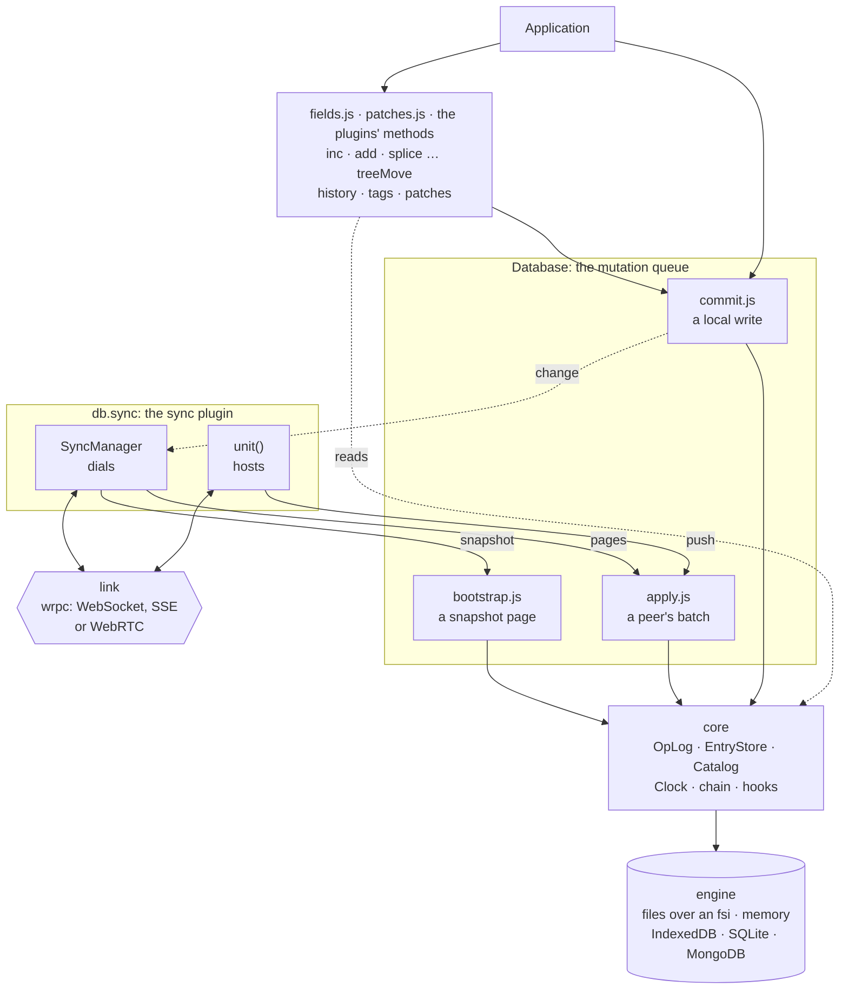
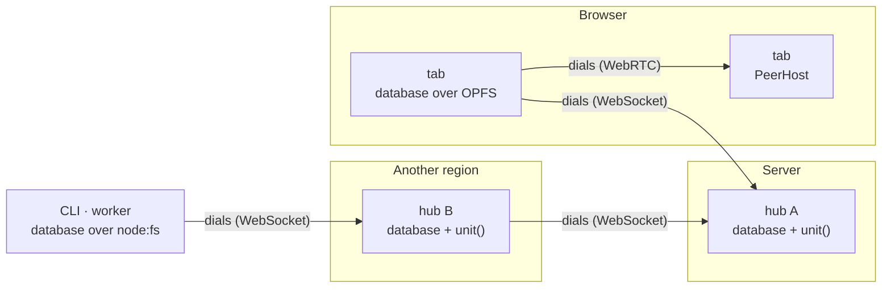
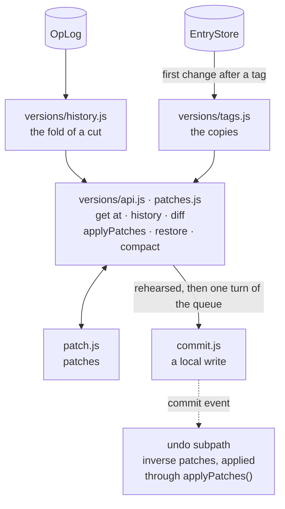

# Architecture

This page is the map for someone about to change syncom's code: what a database is made of, the three
ways a write enters it, how two nodes replicate, how the past is read back, where the bytes go, and
which files hold each part. Each part has a guide of its own, linked from its section, and each
folder of `src/` has a `CLAUDE.md` with the rules its code keeps.

## The big picture

A `Database` (`src/database.js`) is the object an application opens. It owns the **mutation queue**:
every write runs inside it, one at a time. It lends its collaborators (the log, the clock, the
catalog, the record store, the chain, the hooks) as one frozen object, the `core`, to the three write
paths, to the modules behind its methods (`src/fields.js` for counters and sets, `src/patches.js` for
patches) and to the plugins' methods, and to nothing else. Everything that touches the outside world
is injected: the engine that stores the bytes, the transport (a link), the validator, the text index,
the telemetry writer.



Three ideas hold the design together. **Three write paths, one core**: a local write goes through
`src/commit.js`, a peer's page through `src/apply.js`, a snapshot page through `src/bootstrap.js`; all
three run inside the queue and end in the same record store, and there is no fourth, so a `splice()`, a
`restore()` or an undo is a local write like `update()`. **Log first, then data**: an op is appended to
the [operation log](./operation-log) before its record is written, so a crash between the two is
replayed at the next open, and the chain and the catalog are derived from what was written. **Events
never run inside a write**: hooks do, and can change or refuse the operation, while events (`change`,
`commit`, `transaction`, `sync`) leave after it, and a listener that throws breaks nothing ([Hooks and
events](./hooks)).

## A local write

`db.Task.update(id, { done: true })`, step by step. An insert, an increment, a splice, a tree move, a
delete or a purge take the same road with another op type.

```mermaid
sequenceDiagram
  autonumber
  participant A as application
  participant Q as mutation queue
  participant C as commit.js
  participant L as OpLog
  participant B as chain plugin
  participant E as EntryStore + Catalog
  participant S as SyncManager
  A->>Q: update(id, { done: true })
  Q->>C: run when the queue reaches it
  C->>C: beforeWrite hook · kind check · stamp from the clock · index resolved · applyOp
  C->>C: validator (folded into the op) · unique keys
  C->>C: link to the stream (prev) · sign (Ed25519), unless signatures: false
  C->>L: append(op): the seq reserved, the entry in flight; the queue moves on
  L->>L: the group's file, every op appended meanwhile, written; the ticket resolves
  C->>B: block(hash of the record), unless chain: false
  C->>E: one write set: the block and its tail, the record, its catalog row
  C->>L: applied(seq)
  C->>C: afterWrite hook · refresh live documents · commit event
  C-->>S: change(op)
  S->>S: push to every peer, in order
  C-->>A: resolves
```

The field's kind is checked before anything is stamped (`FIELD_KIND`), and an index, a sibling or a
range is resolved inside the queue, against the record as it is. A write that changes nothing stops
after `applyOp` and appends nothing. The queue holds a write only up to the append (step 6): from there
the next write runs, building on the entry in flight, while the disk is written outside the queue.
Steps 7 to 12 come in log order once the op's group is on disk, and that is what the caller awaits.
Appends that arrive while a group is written join the next one, so a burst costs one log write.

Two paths shorten this. Under `createDatabase({ defer })` (16 ms by default) steps 8 to 10 wait for a
timer, so the writes of one record within the window land as one file; the log is durable at once and
reads see the entry meanwhile. And a write that a turn of the queue would not change (no hooks, no
signing, no validator, the record cached, the queue idle) is made at once, outside the queue
(`commitAtOnce` in `src/commit.js`). The catalog file is saved off the queue, so a write never waits
for it.

## A peer's batch

`applyRemote(ops)` (`src/apply.js`) is the trust boundary: every op of a page has its shape checked,
its signature verified and its fingerprint taken first, then each is admitted (inside the skew bound,
the next of its stream, following the op this node holds before it), applied one by one with
`applyOp`, and the batch is made durable, log first, then the records, and announced. A host's push
also checks the peer's scopes and its `authorizeWrite` rule. [The sync
protocol](./sync-protocol#how-a-host-admits-a-peer-s-batch) walks the gate in order.

## Two nodes

Every node can do both: dial a host and serve its own unit. A dialer says hello, pushes what the host
lacks, and subscribes to the host's feed from the last event id it saw. From then on ops flow both
ways, and every node relays what it applies to its other peers.



A dialer that comes back resumes from its cursor, which wrpc's subscriptions keep; one that was away
longer than the host's retention, or a new one on a compacted host, joins a snapshot instead. The host
enforces scopes and rules; every op's signature is verified against its origin, since the node id is
the key. Reconnecting belongs to the link: syncom runs no reconnect loop or timer, and a failed push
marks the peer as behind until the next sign of life on the link. The dialing side is
`src/sync/manager.js`, the hosting side `src/sync/hosting.js`, the reads a thin client makes
`src/sync/reads.js`, and the hubs' shared log `src/sync/shared.js`. See [The sync
protocol](./sync-protocol) and [Scaling](./server-scaling).

## Convergence

An op is applied by `applyOp` in `src/ops.js`, the same function on every node. A register is
last-writer-wins, ordered by `(ts, origin)`, with stamps from a clock that never falls behind a stamp
the node has seen. A counter is a sum per stream, so concurrent increments add up. A set keeps, per
element and origin, the newest add and the newest add a remove had seen, so concurrent adds survive a
remove that did not see them. Lists and texts (`src/text/`) are Fugue trees of runs held in a
copy-on-write rope, and a tree (`src/tree/`) is the fold of every node's moves in stamp order, a move
that would make a cycle skipped. A field two nodes create as different kinds at once ends as one kind
everywhere, by a precedence that reads the kinds alone. A delete is a tombstone that a newer write
revives; a purge wins at any stamp and scrubs the record from the log.

Any order, any number of times, gives the same record. What a peer can make a node hold is bounded the
same way on the op path and in a snapshot (run and field lengths, pending work, tree depth), and past a
bound an op is refused, never half applied. [Fields that merge](./fields) and [CRDT](./crdt) explain the
kinds; [Wire format](../reference/wire#bounds) lists the bounds.

## Versions

The past is read out of the log, and every way back to it is new ops through the local write path:
nothing rewrites the log or a record file.



A version is a fold: `get(id, { at })` and `history(id)` take the log's entries of the record up to a
cut (an event id, a stamp or a vector) and fold them with the same `applyOp`, which is exact while the
log still holds what the record depends on. A tag is copy-on-write at the record store: before a
record's first change after the newest tag, its file is copied into that tag. Patches are the write
API's terms: `diff()` hands out `put`, `inc`, `add`, `splice`, `treeMove` and the rest by field kind,
and `applyPatches()` rehearses them over a scratch record before it commits them in one turn of the
queue, so a `restore()` lands whole or not at all. Undo (`src/undo/`) and branches (`src/branch/`) are
subpaths over the public API. See [Versions and history](./versions).

## Where the bytes go

A database stores every byte through its engine (`src/engine.js` is the contract). The files engine
(`src/files/files.js`), the default, writes over an `fsi`, five file functions in `src/backend.js`
implemented by `node:fs` (`src/fsi.js`) and OPFS (`src/fsi.browser.js`). Under it a database is one
directory:

```
board/
├── node.json      this node's identity: its signing key with the signing plugin, else what getId minted
├── keys/          the key pairs of the signing and encryption plugins
├── blockchain/    one block per write, and the tail (the chain plugin, unless chain: false)
├── lock.json      while an instance holds the directory
├── schema.json    the schema version this directory last ran
├── index/         catalog.json: derived (ids, indexes, search text), rebuilt when missing
├── data/          <id>.json per record: data, meta, the block that committed it; a large text's runs in pieces beside it
├── log/           the operation log: the journal of open groups and the sealed segments
├── tombstones/    tombstones folded by cleanup
├── remote/        one file per registered sync node
├── local/         local documents, never replicated
├── pipeline/      the pipelines' checkpoints
├── blobs/         attachments' bytes by digest
├── tags.json      the tags taken here, once there is one
└── tags/          per tag: its catalog, and the record files copied before their first change
```

A native engine keeps the same stores in its own structures, every key prefixed by the database's
path so one medium serves many databases: Maps in memory (`src/memory/engine.js`), object stores in
IndexedDB (`src/idb/engine.js`), tables in one SQLite file (`src/sqlite/sqlite.js`), collections in one
MongoDB database (`src/mongodb/mongodb.js`). A write set is one transaction where the medium has them. `src/layout.js`
lists every directory a database may keep, and [Wire format](../reference/wire#in-an-engine) names
every key.

## Plugins

`createDatabase({ plugins })` builds one registry per database (`src/plugin.js`); nothing is global to
the process. A **kind** plugin (`text`, `tree`) adds field kinds: their op types are the protocol's, so
a node without the plugin still logs and relays their ops, but refuses to apply them to its own
records. An **api** plugin hands the core a hook through one seam: `setup(ctx)` before the log opens
(`signing` the identity, `encryption` the seal, `chain` the audit chain, and `schema`, `query`,
`versions`, `telemetry`), or `open(ctx)` after the replay (`sync`, which gives `db.sync`). The core asks
for a hook and works without it: no signing plugin, no signatures; no chain plugin, no blocks.
`src/all/all.js` is the core with every shipped plugin registered. See [Plugins](./plugins).

## Where to look

| Area | Files |
| --- | --- |
| The facade, its queue, the core it lends | `src/database.js`, `src/collection.js`, `src/document.js` |
| The three write paths | `src/commit.js`, `src/apply.js`, `src/bootstrap.js` |
| The op model, clocks and vectors | `src/ops.js`, `src/vector.js`, `src/header.js`, `src/shape.js` |
| The log and the records | `src/log.js`, `src/files/journal.js`, `src/entries.js`, `src/catalog.js` |
| Replication | `src/sync/manager.js`, `src/sync/hosting.js`, `src/sync/outbound.js`, `src/scope.js`, `src/wrpc/wrpc.js` |
| Lists, texts and trees | `src/text/sequence.js`, `src/text/rope.js`, `src/tree/moves.js` |
| Versions, patches, undo | `src/versions/api.js`, `src/patch.js`, `src/patches.js`, `src/undo/undo.js` |
| Engines | `src/engine.js`, `src/files/files.js`, `src/memory/engine.js`, `src/idb/engine.js`, `src/sqlite/sqlite.js`, `src/mongodb/mongodb.js` |
| Hooks, events, errors | `src/hooks.js`, `src/emitter.js`, `src/errors.js` |

Every subpath is a folder under `src/` with its entry and its types beside it, and a folder is a zone:
a module of the zone lives there even when the core requires it (`src/sync/wire.js`,
`src/telemetry/writer.js`). The browser halves are `*.browser.js` files that replace their Node.js
twin through the `browser` field of `package.json`: `fsi`, `utils`, `crc32` and `crypto/digest` in
the core, `signing/ed25519` and `encryption/rsa` in their subpaths; everything else is shared. The
package is CommonJS with no build step and no runtime dependencies.

Before you change anything, read `CONTRIBUTING.md` and the `CLAUDE.md` of the folder you touch. Every
test suite of a plugin runs twice, over `@alexify/syncom/all` and over the core with the plugins given
by hand, the convergence properties run over `@alexify/syncom/testing`'s mesh, and `INVARIANTS.md`
names the test that holds each guarantee.
