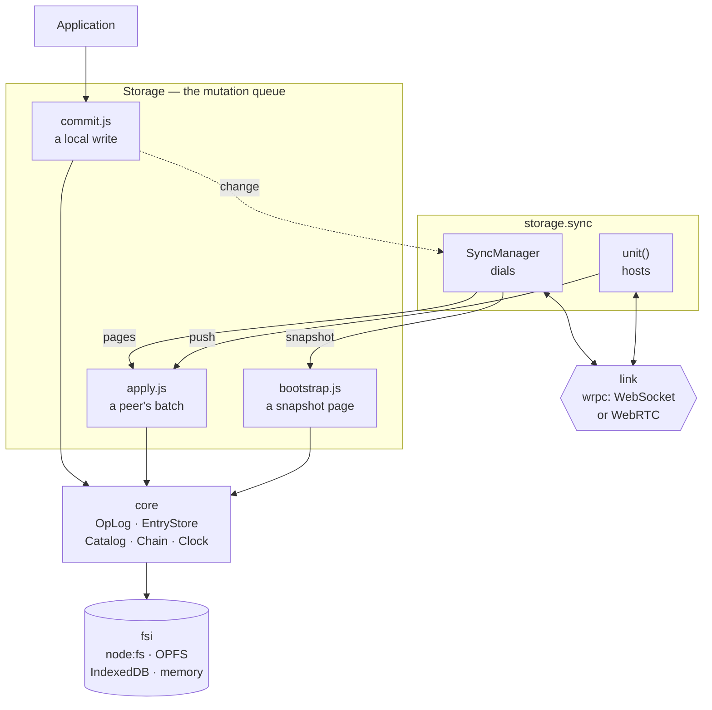
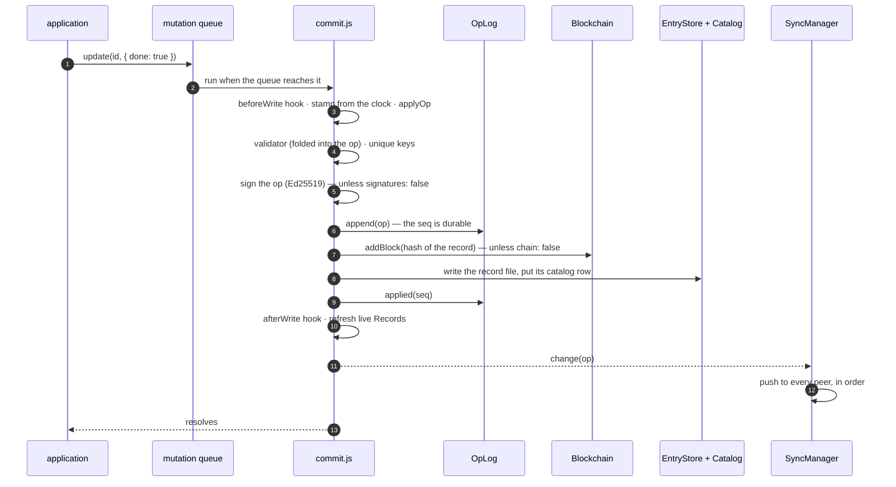
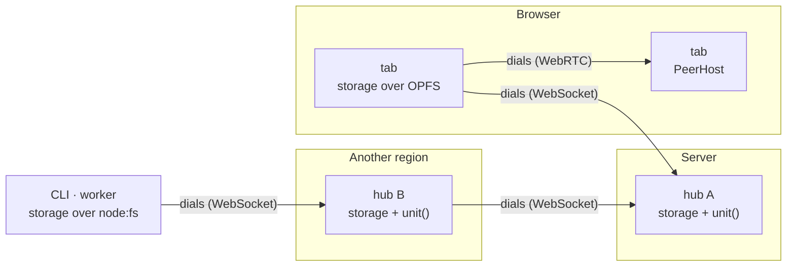

# Architecture

This page shows how syncom is put together: what a storage is made of, the three paths a write
can take into it, how two nodes replicate, and what lies on disk. Each part has a guide of its
own; this page is the map between them.

## The big picture

A `Storage` is the facade an application opens. It owns the **mutation queue**: every write runs
inside it, one at a time. It lends its collaborators (the log, the clock, the chain, the
records) to three write paths, and to nothing else. `storage.sync` is the replication: the
dialing side (`SyncManager`) and the hosting side (`unit()`). Everything that touches the
outside world is injected: the backend (`fsi`), the transport (a link), the validator, the
telemetry.



- **Three write paths, one core.** A local write goes through `src/commit.js`, a peer's page
  through `src/apply.js`, a snapshot page through `src/bootstrap.js`. All three run inside the
  queue, all three end in the same `EntryStore.write`, and there is no fourth.
- **Log first, then data.** An op is appended to the log before its record is written, so a
  crash between the two is replayed on the next open. The chain and the catalog are derived
  from what was written.
- **Events never run inside a write.** Hooks do: they can change or refuse the operation.
  Events (`change`, `apply`, `sync`, …) leave after it, and a listener that throws cannot
  break anything. See [Hooks and events](/guide/hooks).

## A local write

`storage.update(id, { done: true })`, step by step. An insert, an increment, an add to a set, a
delete or a purge take the same road with another op type.



A write that changes nothing stops after `applyOp` and appends nothing. A record written with
`encrypted: true` is sealed for this node's key and produces no op. The catalog file is saved
off the queue, so a write never waits for it.

## Two nodes

Every node can do both: dial a host and serve its own unit. A dialer says hello, pushes what the
host lacks, and subscribes to the host's feed from the last event id it saw. From then on, ops
flow both ways and every node relays what it applies to its other peers.



- **Resume, or bootstrap.** A dialer that comes back resumes from its cursor, which wrpc's
  subscriptions keep. One that has been away longer than the host keeps its log, or a new one,
  receives a streamed snapshot instead and joins each page of it as one batch. See
  [Sync](/guide/sync#bootstrap).
- **The host enforces.** `push` drops the ops outside the peer's scopes before applying the
  rest. `changes` and `snapshot` serve only the scopes `grant()` allows. Every op's signature is
  verified against its origin — the node id is the key — and every op is checked for shape and
  clock skew before anything reads it. See [Signatures](/guide/sync#signatures), and
  [Scaling](/guide/scaling) for hubs that dial each other.
- **Reconnects belong to the link.** syncom runs no reconnect loop or timer of its own. A failed
  push marks the peer as behind, and the next sign of life on the link sends what is missing.

The handshake, message by message, is on the [Sync](/guide/sync) page.

## Convergence

An op is applied by `applyOp` in `src/ops.js`, the same function on every node:

- a **field** is a last-writer-wins register, ordered by `(ts, origin)`; `ts` comes from a clock
  that never falls behind a stamp the node has seen;
- a **counter** is a sum per origin, so concurrent increments add up;
- a **set** keeps, per element and origin, the newest add and the newest add a remove had
  observed, so concurrent adds both keep and an add a remove did not see survives it;
- a **list** or a **text** is a tree of runs (Fugue): an element's place is the right child of
  the one before it or the left child of the leftmost descendant of its first right child, so
  concurrent inserts at one spot both keep and each writer's run stays whole; a deleted element
  keeps its place, and a list's elements carry a position and a value register, a text's marks
  two anchors each (see [Lists, text and trees](/guide/lists));
- a **tree** is the fold of every node's moves in stamp order, a move that would put a node
  under itself skipped (Kleppmann et al., 2021), so two nodes agree on which concurrent move
  lost; siblings order by a fractional index, then by stamp;
- a **delete** is a tombstone that a newer write revives; a **purge** wins at any stamp and
  scrubs the id from the log;
- ops from one origin apply in sequence order; a duplicate or a gap is skipped, and resuming
  from the last event id fills the gap.

Any order, any number of times, gives the same record. See
[Registers, counters, sets, lists and text](/guide/sync#registers-counters-sets-lists-and-text).

## On disk

A storage is one directory, through whichever `fsi` it was given:

```
data/
├── node.json      this node's identity: its signing key
├── keys/          two key pairs: RSA (encryption at rest), Ed25519 (signing ops)
├── blockchain/    one block per write, and the tail (unless chain: false)
├── lock.json      while an instance holds the directory
├── schema.json    the schema version this directory last ran
├── index/         catalog.json — derived (ids, indexes, search text), rebuilt when missing
├── data/          <id>.json per record: data, meta, the block that committed it
├── log/           the operation log: open files and sealed segments
└── remote/        one file per registered sync node
```

[Storage](/guide/storage#on-disk) explains each file, and [Backends](/guide/backends) explains
the five functions an `fsi` implements.

## The modules

| Module | Role |
| --- | --- |
| `storage.js` | The facade: the open sequence, the mutation queue, the public API, the `core` it lends |
| `commit.js`, `apply.js`, `bootstrap.js` | The three write paths |
| `entries.js`, `catalog.js` | Record files, the bounded cache, the catalog (ids, indexes, tombstones) |
| `log.js` | `OpLog`, the persisted operation log: append, seal, retention, scrub |
| `ops.js`, `vector.js` | The op model (`applyOp`), clocks and version vectors |
| `chain.js` | The hash-linked chain |
| `schema.js`, `query.js` | Validators, versions and lenses; Mango cursors, `$text` among them |
| `search.js` | The `@alexify/syncom/search` subpath: the trigram index behind `$text` — the core knows only its contract |
| `signing.js` | What an op's signature covers, signing and verifying it |
| `sync.js`, `hosting.js`, `link.js`, `wrpc.js` | Dialing, hosting, the link contract, the wrpc adapter |
| `hooks.js`, `telemetry.js`, `errors.js` | Hooks and events, injected OpenTelemetry, `SyncomError` |
| `fsi.js`, `fsi.browser.js`, `idb.js`, `backend.js` | `node:fs`, OPFS, IndexedDB and memory backends |

The browser halves (`*.browser.js`) replace `fsi`, `crypto` and `utils` through the `browser`
field of `package.json`; everything else is shared.
