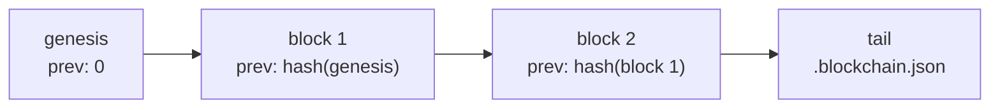

# Blockchain log

Every write a storage applies is committed to an append-only, hash-linked log,
unless it was opened with `chain: false` (see [Through storage](#through-storage)).
Each block names its predecessor by hash, so changing any block invalidates
every block after it.



## Using it directly

```js
const { Blockchain } = require('@alexify/syncom');

const chain = await new Blockchain('data/blockchain');
```

::: tip The constructor returns a promise
`Blockchain` initialises asynchronously — it reads or writes the genesis block
before it is usable — so it is always `await new Blockchain(...)`. The same is
true of `Storage` and `SyncManager`. The types model this.
:::

```js
const hash = await chain.addBlock({ id: 'r1', hash: 'abc' });
const block = await chain.readBlock(hash);
// { prev: '<previous hash>', timestamp: 1757000000000, data: { id: 'r1', hash: 'abc' } }
```

A block is `{ prev, timestamp, data }`. Its own hash is the SHA-256 of that
object, and it is stored as `<hash>.json`. The tail hash lives in
`.blockchain.json` so the chain can be reopened without scanning the directory.

`readBlock` throws on an unknown hash.

## Validating

```js
await chain.validate({ last: 10 });        // the 10 most recent blocks
await chain.validate({ from: someHash });  // backwards from a given block
await chain.validate();                    // the whole chain
```

Validation re-hashes each block and compares it to the hash it is filed under.
It walks backwards until it reaches the genesis block (`prev === '0'`) or the
`last` limit.

Cost is linear in the number of blocks visited, and each visit is a file read —
`validate()` over a long chain is slow by construction. Bound it with `last`
on hot paths. See `bench/chain.js` for the numbers.

## Through storage

`Storage` keeps its own chain and adds a block for every write it applies. A
local write commits `{ id, hash, from }` — the record, the hash of its data,
and its position in the [log](./sync#the-log); a batch of ops applied from a
peer commits one block `{ records: { [id]: hash }, from, to }` for every record
it touched. `validate(id, data, block)` accepts both shapes.

Each node's chain is its **own** audit log: the order in which *it* applied
things. Two nodes that hold the same records hold different chains — that is
expected, and it is not a consensus mechanism.

The chain grows by one block file per local write and one per batch applied
from a peer, and it is never compacted — the log is, the chain is the audit.
A node that only replicates, a hub, has nothing to audit: `open({ chain:
false })` keeps none, saves two file writes per record, reads records without
re-verifying them (`integrity` is lazy, there is no block to check against),
and `validate()` rejects with `code: 'NO_CHAIN'`.

```js
await storage.validate({ last: 10 }); // delegates to the chain
```

The per-record form checks one entry against its committing block:

```js
const entry = JSON.parse(await fsi.read('data/data', `${id}.json`));
await storage.validate(id, entry.data, entry.block); // true if intact
```

This is exactly what `loadData` does on every read — a record whose bytes no
longer hash to what its block recorded raises
`Storage record <id> is invalid` rather than returning the modified data.
