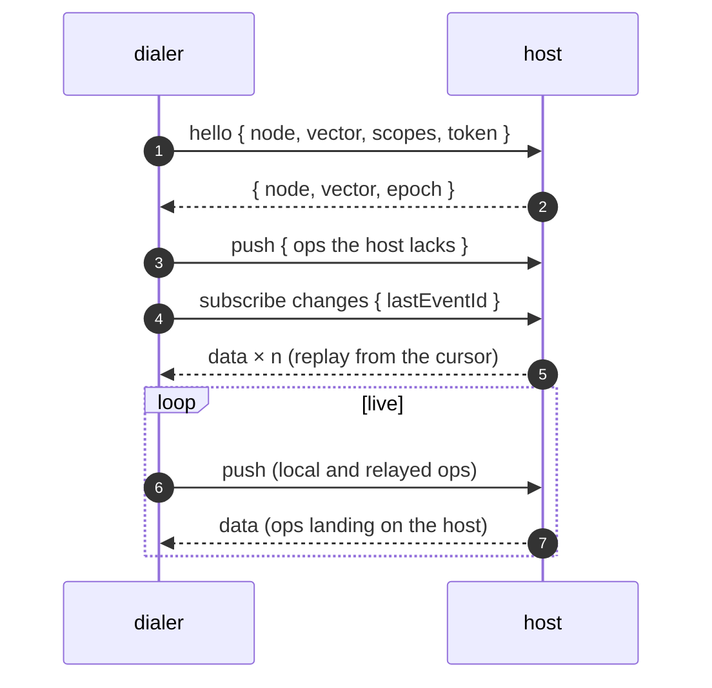

# Sync

`storage.sync` replicates a storage with other nodes. Every node is a peer:
it applies its own writes, applies what its peers send, and forwards both to
everyone else it talks to. There is no coordinator and no consensus — records
converge because every operation is designed to be applied in any order, any
number of times, with the same result.

The transport is **injected**. syncom describes the small contract a link has
to satisfy, ships an adapter for [wrpc](./wrpc), and depends on nothing.

```js
const { open } = require('@alexify/syncom');
const { createWrpcLink } = require('@alexify/syncom/wrpc');
const { WrpcClient } = require('@alexify/wrpc');

const storage = await open({
  path: 'data',
  sync: {
    connect: async (node) => createWrpcLink(await WrpcClient.connect(node.url)),
  },
});

await storage.sync.addNode({ url: 'ws://hub.example.com:8000/api', token: 'secret' });
// From here on, writes flow both ways.
```

## Operations

Every write becomes an **op** — the unit that travels between nodes and sits
in the log:

```
{ origin, seq, ts, type, id, scope?, data?, key?, value? }
```

| `type` | Produced by | Effect on the record |
| --- | --- | --- |
| `write` | `insert()`, `set()`, `saveData()` | Replaces the record: fields not written are gone |
| `set` | `update()`, `swap()`, `record.save()` | Replaces the listed fields; last writer wins per field |
| `inc` | `inc()`, `record.inc()` | Adds to a counter field |
| `delete` | `delete()`, `record.delete()` | Leaves a tombstone; a newer write revives the record |
| `merge` | a snapshot page being joined | Joins a whole entry (see [Bootstrap](#bootstrap)) |
| `advance` | a snapshot being joined | Records which ops the joined state already covers |

`origin` is the node that made the op, `seq` its sequence number on that node,
`ts` a millisecond stamp that never runs backwards and never falls behind a
stamp the node has seen from a peer.

### Registers and counters

A field is either a **register** or a **counter**, never both.

- A register holds whatever was written last: two nodes writing the same field
  concurrently agree on the winner by `(ts, origin)`, so both end up with the
  same value.
- A counter is a sum. Two nodes each adding 1 concurrently end up at +2 on
  both, because the sum keeps one running total per origin and adds them up.

```js
const id = await storage.insert({ title: 'Draft' }); // title is a register
await storage.inc(id, 'views', 1);                   // views is a counter
await storage.update(id, { title: 'Final' });        // fine
await storage.update(id, { views: 10 });              // throws: views is a counter; use inc()
await storage.inc(id, 'title', 1);                    // throws: title is a register; use update()
```

Do not initialise a counter in `insert()` — `{ views: 0 }` makes `views` a
register. `inc()` creates the field. A peer's op that breaks the rule is
refused for that field and reported as an `error` event on the storage; the
rest of the op still applies.

### Whole-record writes and deletes

`set()` and `delete()` reset the record: a concurrent `update()` from another
node that is *older* than the reset loses the fields it wrote, one that is
*newer* keeps them — whichever order the two arrive in. A `delete()` leaves a
tombstone that hides the record from `get()`, `has()` and `list()`; any newer
write brings it back.

One case does not converge and is left that way on purpose: a counter
incremented by one origin both before and after a concurrent reset by another.
Resettable counters need causal metadata syncom does not carry.

## The log

Every op a node applies — its own and its peers' — is appended to
`<path>/log/` before the record is written, so a crash between the two is
recovered by replaying the log on the next open:

```
log/
├── open/<seq>.json     one file per appended batch, never rewritten
├── seg-<from>.json     sealed segments, rolled from open/ every `rollAfter` batches
└── index.json          { epoch, floor, vector, segments }
```

The log has two cursors, for two different questions.

**Where am I in *your* log?** An **event id** — `<epoch>.<seq>` — names a
position in one node's log. It is what a subscriber hands back to resume, and
it is exactly what wrpc carries as a subscription's `lastEventId`. The epoch is
minted when the log is created, so an id from a wiped or restored directory is
recognised as foreign rather than mistaken for a position.

**What have I applied?** A **version vector** — `{ [origin]: seq }` — is the
highest sequence number applied per origin. Sequence numbers run per origin
*and scope*, so a node syncing one scope sees no holes; the key is then
`origin@scope`. Ops from one origin are applied in order; an op that skips
ahead is set aside until the ones before it arrive.

Retention bounds the log: `retention.ops` (default 10 000) and
`retention.days` drop the oldest sealed segments, and `floor` moves up. A
peer whose cursor fell below the floor cannot be resumed — it is told to
[bootstrap](#bootstrap) instead. Size retention for the longest outage a peer
should be able to sit out.

## Protocol

A node **dials** the nodes in its registry through `connect(node)`; the node
on the other end **hosts** a unit of procedures. Both roles are the same class;
which one a node plays on a given link is just who opened the connection.

| Procedure | Direction | Purpose |
| --- | --- | --- |
| `hello` | dialer → host | Exchange node ids, vectors and log epochs; the host may `authorize` |
| `push` | dialer → host | Ops the host lacks, by its vector |
| `changes` (subscription) | host → dialer | Everything that lands in the host's log from the cursor on, live |
| `snapshot` | dialer → host | One page of the host's state, for bootstrap |



A push carries the dialer's own writes **and** what it received from its other
peers, so ops travel across the mesh hop by hop. The version vector stops them
looping: an op a node already has is dropped, not re-sent. Each op reaches a
node at most as many times as that node has links.

The subscription's cursor is remembered per registered node. Reconnecting,
backing off and re-opening the subscription from the last event id are the
**link's** job — a wrpc client already does all three. After a reconnect the
manager only repeats `hello` + `push`, the outbound half a transport cannot know
about.

### Bootstrap

A dialer whose cursor the host cannot resume — a brand-new node, or one that was
away longer than the host's retention — receives `{ bootstrap: true }` on the
subscription, and switches to `snapshot`. The host pages through **every**
entry, tombstones included, with its merge metadata. On a binary-capable
transport a page is streamed as NDJSON with backpressure; otherwise it comes
inline. The dialer joins each record (`mergeEntry`), adopts the host's vector as
of the first page, and re-subscribes from that page's event id. Whatever landed
while paging replays and folds in as a no-op.

The joined state enters the dialer's own log as `merge` and `advance` ops, so
a third node resuming from the dialer gets it too — bootstrap is transitive.
Those ops never travel back to the node the snapshot came from.

## Scopes

By default a storage is one scope, `'*'`, and every peer gets everything. To
replicate a subset, assign records to scopes and register the peer with the
scopes it should carry:

```js
const storage = await open({
  path: 'data',
  sync: {
    connect,
    scope: (id, data) => data.$type ?? '*', // a record's scope, from its data
  },
});

await storage.sync.addNode({ url, scopes: ['Doc'] }); // Doc records, plus everything global
```

An unscoped record (scope `'*'`) reaches every peer. On a wrpc host the
subscriber joins the room `syncom:<scope>` for each scope it asked for, so
`server.rooms.count('syncom:Doc')` and the cluster's `fetchClients({ room })`
describe the sync topology without any code in syncom. Delivery itself stays
on the subscription — a room broadcast is at-most-once and cannot be resumed.

A node that carries one scope can only relay that scope: a peer wanting more
has to reach a fuller node.

## The registry

```js
await storage.sync.addNode({ url: 'wss://peer/api', token: 'secret', scopes: ['*'] });
await storage.sync.enableNode('wss://peer/api', false); // keep, but do not dial
await storage.sync.removeNode('wss://peer/api');
storage.sync.listNodes();
// [{ url, token, scopes, enabled, lastSync, cursor, remote: { id, epoch } }]
```

Each node is a file under `<path>/remote/`, named by its percent-encoded url,
on Node.js and in the browser alike. The `cursor` and the remote node's identity
are kept there too, which is why a restart resumes instead of bootstrapping.

`url` is whatever `connect(node)` understands — syncom never parses it.

## Lifecycle and events

```js
await storage.sync.start(); // dial every enabled node; automatic when `connect` is given
await storage.sync.stop();  // close every link
await storage.sync.sync();  // push what the peers lack right now
storage.sync.peers();       // [{ url, node, connected, subscribed, cursor, lastSync, pending }]

storage.sync.on('peer', ({ url, connected, node, reconnected }) => {});
storage.sync.on('sync', ({ url, pushed, received, applied, duplicates, gaps }) => {});
storage.sync.on('bootstrap', ({ url, records }) => {});
storage.sync.on('error', (error) => {}); // error.url names the peer

storage.on('change', (op, via) => {});  // every op applied here; via is null for a local write
storage.on('error', (error) => {});     // a peer's op refused by the register/counter rule
```

`await storage.close()` stops sync and seals the log.

## Options

| `sync.…` | Default | Meaning |
| --- | --- | --- |
| `connect(node)` | — | Returns a link (or a promise of one) for a registry node. Required to dial. |
| `autoStart` | `true` when `connect` is given | Dial on open |
| `scope(id, data)` | `() => '*'` | The scope of a record |
| `retention.ops` | `10000` | Ops kept in the log before the oldest segment is dropped |
| `retention.days` | — | Age after which a segment is dropped |
| `log.rollAfter` | `64` | Appended batches per sealed segment |
| `pageSize` | `500` | Ops per push, records per snapshot page |

## Hosting

The unit a wrpc server (or anything shaped like one) mounts:

```js
const unit = storage.sync.unit({
  access: 'public',                                    // wrpc's default is 'session'
  authorize: (context, hello) => hello.token === TOKEN, // the node's token, or context.session…
});
```

| Option | Default | Meaning |
| --- | --- | --- |
| `access` | `'session'` | Applied to every procedure, wrpc-style |
| `authorize(context, hello)` | — | Gate the handshake; `hello.token` is the dialer's registered token |
| `tracked` | built in | wrpc's `tracked()`; the built-in produces the same shape |
| `pageSize` | `500` | Records per snapshot page |
| `pageBytes` | `4 MiB` | Above this a page is sent inline rather than streamed |

See [wrpc transport](./wrpc) for mounting it.

## The link contract

Anything with this shape can carry the protocol; `isSyncLink()` is the check:

```ts
interface SyncLink {
  call(method: string, args: unknown): Promise<unknown>;
  subscribe(method, args, { lastEventId, onData(value, eventId), onError, onEnd }): { unsubscribe() };
  stream?(id: string): AsyncIterable<Uint8Array>; // binary-capable transports
  on(event: 'open' | 'close' | 'reconnect', listener): void;
  off(event, listener): void;
  close(): void;
}
```

`tests/utils/memory-link.js` in the repository is an in-process implementation
the engine's own tests run on.

## Guarantees and limits

- **Convergence.** Two nodes that have applied the same set of ops hold the
  same records, whatever the order — except the documented counter/reset case.
- **At-least-once delivery, idempotent application.** An op may arrive more
  than once; applying it again changes nothing.
- **A node's own sequence never repeats.** The log is written before the op is
  announced, so a crash cannot mint two different ops with one number.
- **No fsync.** Files are written with the platform's default durability; on
  OPFS there is no rename either, so a torn write can only affect the newest,
  unannounced batch.
- **Encrypted records do not sync.** They are sealed for this node's key alone
  — see [Storage](./storage#encryption-at-rest).
- **Chains diverge.** Each node's [chain](./chain) is its own audit log of what
  it applied, in the order it applied it. It is not a consensus.
- **No signatures.** Trust rests on `authorize`, the token and the transport
  (use `wss://`).
