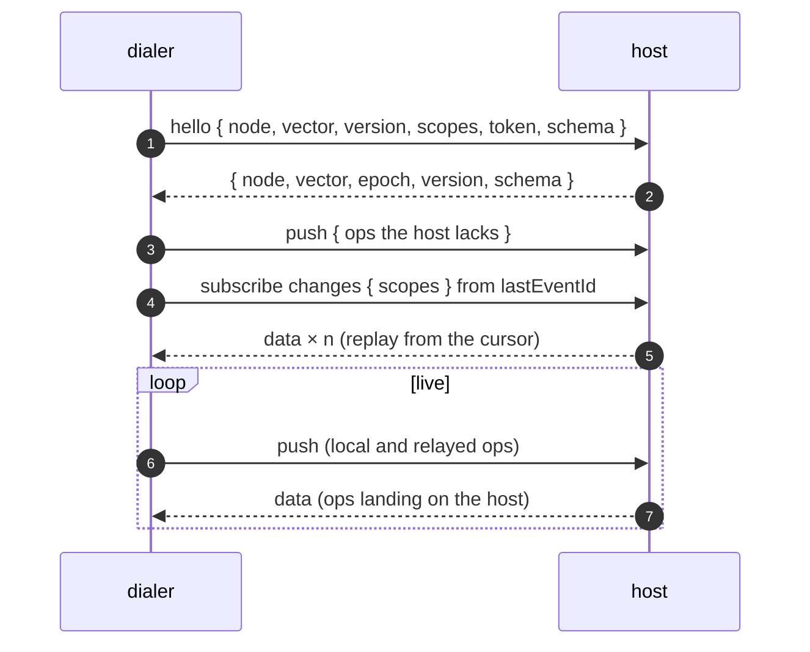

# Sync

`storage.sync` replicates a storage with other nodes. Every node is a peer:
it applies its own writes, applies what its peers send, and forwards both to
everyone else it talks to. There is no coordinator and no consensus — records
converge because every operation is designed to be applied in any order, any
number of times, with the same result.

The transport is **injected**. syncom describes the small contract a link has
to satisfy, ships an adapter for [wrpc](./wrpc), and depends on nothing. The
manager itself is the `sync` plugin — `@alexify/syncom/sync`, registered by
`@alexify/syncom/all`; the examples on this page open the core with it:

```js
const { open } = require('@alexify/syncom');
const { sync } = require('@alexify/syncom/sync');
const { createWrpcLink } = require('@alexify/syncom/wrpc');
const { WrpcClient } = require('@alexify/wrpc');

const storage = await open({
  path: 'data',
  plugins: [sync],
  sync: {
    connect: async (node) => createWrpcLink(await WrpcClient.connect(node.url)),
  },
});

await storage.sync.addNode({ url: 'ws://hub.example.com:8000/api', token: 'secret' });
// From here on, writes flow both ways.
```

## Operations

Every write becomes an **op** — the unit that travels between nodes and sits
in the log:

```
{ origin, seq, ts, type, id?, scope?, data?, meta?, key?, value?, vector?, from?, v?, actor?, sig?, digest?, nonce?, msg? }
```

| `type` | Produced by | Effect on the record |
| --- | --- | --- |
| `write` | `insert()`, `set()`, `saveData()` | Replaces the record: fields not written are gone |
| `set` | `update()`, `swap()`, `record.save()` | Replaces the listed fields; last writer wins per field |
| `inc` | `inc()`, `record.inc()` | Adds to a counter field |
| `add` | `add()`, `record.add()` | Adds elements to a set field |
| `remove` | `remove()`, `record.remove()` | Removes from a set field the elements this node had seen added |
| `splice` | `splice()`, `push()`, `updateText()`, `record.splice()`, `record.push()`, `record.updateText()` | Removes a range of a list or text field and inserts at a place — see [Lists, text and trees](./lists) |
| `assign` | `setAt()`, `record.setAt()` | Sets a list element's value register |
| `move` | `move()`, `record.move()` | Moves a list element: cuts its slot, adds a position run, points its position register at it |
| `mark` | `mark()`, `unmark()`, `unmarkById()`, `record.mark()`, `record.unmark()`, `record.unmarkById()` | Styles a range of a text field between two anchors, or switches a mark off |
| `tree` | `treeMove()`, `treeRemove()`, `record.treeMove()`, `record.treeRemove()` | Moves a node of a tree field under a parent (`$trash`: removed) at a place among its siblings — see [Trees](./lists#trees) |
| `delete` | `delete()`, `record.delete()` | Leaves a tombstone; a newer write revives the record |
| `purge` | `purge()` | Erases the record for good: wins at any stamp, nothing later lands, and every entry of the id is scrubbed from the log (see [Purge](./storage#purge)) |
| `merge` | a snapshot page being joined | Joins a whole entry (see [Bootstrap](#bootstrap)) |
| `advance` | a snapshot being joined | Records which ops the joined state already covers |

`origin` is the node that made the op, `seq` its sequence number on that node,
`ts` a millisecond stamp that never runs backwards and never falls behind a
stamp the node has seen from a peer (see [Clocks](#clocks)). `v` is the
[schema version](./storage#schema-versions) of the node that made it — absent
on a node without a schema, and on `merge`/`advance` — and a record remembers
the version of its last whole-record write as `meta.v`. `actor` is who made
it: `open({ actor })` (a string, or a function asked per write — the
signed-in user) or the write's own `{ actor }`, absent when neither says. It
rides on the op, into every log and every `change` and `beforeApply` on the
way, and never into the record: an audit trail is the log, not the state.
The origin signs it with the rest of the header (see [Signatures](#signatures)),
so no relay can change it on the way — what it names is still the writer's
claim about itself.

[`applyPatches()` and `restore()`](./versions#diff-and-restore), `compact()`
and the [undo stack](./versions#undo-and-redo) write through these same ops;
they have none of their own.

### On the wire

`write` and `set` carry `data`. A field op names its field in `key` and
carries its argument in `value`: the amount of an `inc`, the elements of an
`add`, each element with the add stamps its node had seen for a `remove`,
and for the list, text and tree ops the payload
[What travels](./lists#what-travels) describes —
`splice` `{ cut, at | run + from, content, vals? }`,
`assign` `{ elem, value, k? }`,
`move` `{ elem, cut, at, value }`,
`mark` `{ start, end, key, value, many? }` or `{ off }`,
`tree` `{ node, parent, fi }`.
A `merge` carries `data` and `meta`, an `advance` a `vector`, and both name
in `from` the node whose snapshot was joined.

A push and a `changes` page carry ops packed: one positional array of 18
slots per op — `origin`, `seq`, `ts`, `type`, `id`, `scope`, `data`, `meta`,
`key`, `value`, `vector`, `from`, `v`, `actor`, `sig`, `digest`, `nonce`, `msg` —
with `null` for an absent field and the type as one character: `w` write,
`s` set, `u` unset, `i` inc, `+` add, `-` remove, `/` splice, `=` assign, `^` move, `*`
mark, `~` tree, `d` delete, `p` purge, `m` merge, `a` advance. Slots are
appended, never reordered: a reader of fewer slots ignores the rest, a
reader of more takes an absent one as `null`. The log itself keeps keyed
`{ seq, op }` JSON; packing is for the wire. [Wire format](../reference/wire)
is the byte-level reference: every slot, payload, file and procedure, with
examples.

`hello` carries the protocol version both ways, and a host answers a hello
of another version with 400 (`PROTOCOL`). Version 1 is the wire as the first
publication will have it, with every type and slot above. After that, a new
type — which an older reader counts as malformed, so the stream that carries
it stops there — or a slot an older reader cannot take as `null` is a new
version.

### Clocks

`ts` is `Date.now()`: milliseconds since the epoch, in UTC. Time zones never
enter into it — two nodes in different zones stamp the same instant the same
way. Whether their clocks *agree* is a different matter, and syncom is built so
that they do not have to:

- **Convergence does not depend on clocks.** Ops apply in `seq` order per
  origin, and a register conflict is settled by the pair `(ts, origin)`, which
  is a total order. Two nodes holding the same ops reach the same state
  whatever their wall clocks say.
- **A node's clock never runs backwards and never falls behind what the node
  has seen** — a peer's op, a joined snapshot, or its own entries on disk,
  including across a reopen (the log seeds the clock when it opens). So a write
  that follows a read always outranks what was read, even when the peer that
  wrote it has a clock an hour ahead: a local write can only lose to a write
  it has not seen yet.
- **Concurrent writes go to the faster clock.** When two nodes write the same
  field without seeing each other, the higher `ts` wins on both sides. Skew
  changes *who* wins, never *whether* they agree. Keep clocks NTP-synced if
  "last writer" should mean what a human means by it; for correctness it is
  not required.
- `retention.days` compares stamps with this node's wall clock, so ops stamped
  by a peer far ahead age out late and ops from a peer far behind age out
  early. Retention by `ops` is unaffected.

### Registers, counters, sets, lists and text

A field is a **register**, a **counter**, a **set**, a **list**, a **text** or a
**tree** — one of them, never two.

- A register holds whatever was written last: two nodes writing the same field
  concurrently agree on the winner by `(ts, origin)`, so both end up with the
  same value.
- A counter is a sum. Two nodes each adding 1 concurrently end up at +2 on
  both, because the sum keeps one running total per origin and adds them up.
- A set is an array of JSON values that nodes add to and remove from. Two
  nodes adding different elements concurrently keep both; an element one node
  removes while another re-adds it survives, because a remove names the adds
  its node had seen and the new add is not among them — an *observed-remove*
  set. A set reads sorted by element text: it has no insertion order.
- A list is an array, a text a string, that nodes edit by position with
  `splice()` and `push()`. Two nodes inserting at one spot both keep theirs,
  each writer's run whole, and a deleted element keeps its place so the
  anchors into it still resolve — Fugue, the rule Loro and list-positions
  use. [Lists, text and trees](./lists) has the whole story.
- A tree is nodes with a parent and a place among their siblings, moved with
  `treeMove()` and removed with `treeRemove()`. Two nodes that move
  concurrently so that each would hang under the other agree that the older
  move stands and the newer one lost — Kleppmann's rule, the one Loro uses.
  [Trees](./lists#trees).

```js
const id = await storage.insert({ title: 'Draft' }); // title is a register
await storage.inc(id, 'views', 1);                   // views is a counter
await storage.add(id, 'tags', ['bug', 'ui']);        // tags is a set
await storage.remove(id, 'tags', ['ui']);            // tags is ['bug']
await storage.splice(id, 'body', 0, 0, 'Hello');     // body is a text
await storage.push(id, 'items', [1, 2]);             // items is a list
await storage.treeMove(id, 'outline', 'n1');         // outline is a tree
await storage.update(id, { title: 'Final' });        // fine
await storage.update(id, { views: 10 });              // throws: views is a counter; use inc()
await storage.update(id, { tags: [] });               // throws: tags is a set; use add() or remove()
await storage.inc(id, 'title', 1);                    // throws: title is a register; use update()
await storage.update(id, { body: 'x' });              // throws: body is a text; use splice(), push() or updateText()
```

Do not initialise a counter, a set, a list, a text or a tree in `insert()` —
`{ views: 0 }` makes `views` a register, `{ tags: [] }` and `{ body: '' }`
make theirs registers too; `inc()`, `add()`, `splice()`, `push()` and
`treeMove()` create their fields. A validator's default for the field
(`tags: []`) is folded into the write and does the same. A peer's op that
meets a field of another kind is settled field by field by the kinds'
precedence — see the kind clash below — and the rest of the op still applies.

Elements are told apart by their JSON text: `1` and `'1'` are two elements,
and so are `{ a: 1, b: 2 }` and `{ b: 2, a: 1 }`. A remove of an element this
node never saw added is nothing — no op is made — and one of an element a
peer re-added meanwhile leaves that add alone.

### Whole-record writes and deletes

`set()` and `delete()` reset the record: a concurrent `update()` from another
node that is *older* than the reset loses the fields it wrote, one that is
*newer* keeps them — whichever order the two arrive in. A `delete()` leaves a
tombstone that hides the record from `get()`, `has()` and `list()`; any newer
write brings it back.

One case does not converge and is left that way on purpose: a counter
incremented by one origin both before and after a concurrent reset by another.
Resettable counters need causal metadata syncom does not carry. A set has no
such case: a remove names the add stamps its node saw, so a reset and a
remove read the same whichever lands first. Nor do lists, texts and trees: a
reset drops every run and every tree move stamped below it, and a run stamped
above it but anchored on a dropped element reads from the head of the field.

A **kind clash** — two nodes making one field as different kinds at once: a
whole-record write that carries a field as a register (`set(id, { views: 0 })`,
`set(id, { tags: [] })`) concurrent with an `inc`, an `add` or a `splice` to
that field — is decided by the kinds' precedence, the same on the op path
and in a snapshot merge: a register outranks a counter, a counter a set, a
set a list, a list a text, a text a tree. Where the winner's op arrives, the
loser's state is dropped; where the winner is held, the loser's op is refused
for that field (an `error` event, `OP_REFUSED`, the field's `reason` naming
the kind that holds it) and still logged and relayed. Every node ends with the
same kind whatever the order — and the loser's edits are gone, so keep a field
one kind, and do not reset it in a whole-record write while another node may
be moving it. A local write of the wrong kind is refused before it is stamped
(`FIELD_KIND`).

## The log

Every op a node applies — its own and its peers' — is appended to
`<path>/log/` before the record is written, so a crash between the two is
recovered by replaying the log on the next open:

```
log/
├── open/<seq>-<token>.jsonl  a journal, where the backend has `append`: a line per group of appends (the ops
│                             appended while the group before was written); begun again at every roll, removed
│                             once its groups are sealed, rewritten only by a scrub
├── open/<seq>.json           a group in a file of its own, where the backend has no `append` (OPFS, IndexedDB, atRest)
├── seg-<from>.json           sealed segments, rolled from open/ every `rollAfter` groups: { entries, hash }
└── index.json                { epoch, floor, next, vector, segments, droppedHeld, latestTs, droppedTs }
```

`droppedTs` is the newest stamp among the ops the log no longer holds —
compacted away, or in a segment an open could not read — and `0` while nothing
was ever dropped. It is what a reader of the past checks: the retained entries
of a record are its whole history only from a reset (`write`, `delete`,
`purge`) stamped above `droppedTs`. `storage.log.pin(keep)` holds the
segments such a reader needs, like `retain` does for the sync manager, until
the function it returns is called.

Every log file — a sealed segment, an open group, a journal's line —
carries `hash`, the xxHash32 of its entries' JSON (`src/hash.js`, pure JS,
no key: a checksum, not a signature): a file torn on the way down or altered
on disk does not match at open and is treated as unreadable — a segment lost
and counted in `droppedTs`, an open file or a journal's torn last line
dropped — and `stats().log.corrupt` counts them.

The log has two cursors, for two different questions.

**Where am I in *your* log?** An **event id** — `<epoch>.<seq>` — names a
position in one node's log. It is what a subscriber hands back to resume, and
it is exactly what wrpc carries as a subscription's `lastEventId`. The epoch is
minted when the log is created, so an id from a wiped or restored directory is
recognised as foreign rather than mistaken for a position.

**What have I applied?** A **version vector** — `{ [origin]: seq }` — is the
highest sequence number applied per origin. Sequence numbers run per origin
*and scope*, so a node syncing one scope sees no holes; the key is then
`origin@scope`. Ops from one origin are applied in order; an op that skips
ahead is a gap: it is dropped and counted (`gaps`), and comes again when the
stream is read from the last position that landed.

Retention bounds the log: `retention.ops` (default 10 000) and
`retention.days` drop the oldest sealed segments, and `floor` moves up. A
peer whose cursor fell below the floor cannot be resumed — it is told to
[bootstrap](#bootstrap) instead. Size retention for the longest outage a peer
should be able to sit out.

A node's **own** ops are the exception, because nobody else can hand them to
a host. A node that dials (it has `sync.connect`) keeps every op of its own
until each enabled registered node in its scope has it — `listNodes()` shows
how far each one holds them as `acked`, saved with the registry — so a node
that writes offline for longer than retention still delivers every write
when it reconnects. Only registered nodes are waited for: ops written before
the first `addNode()` are retained like any other, and a host that lacks
ones the log no longer holds is reported once per hello with
`code: 'UNDELIVERABLE'` (those ops are not sent — every one would be a gap
there). Register the node before going offline. A node that is never
reached holds its ops back until it is removed or disabled.

A directory restored from an older copy is noticed at the next hello: the
host holds more of the node's own stream than its log does. The node reports
`code: 'REWOUND'`, moves its streams past what the host holds — so nothing it
mints collides with an op the host already has — and bootstraps from the
host to get back what the lost ops wrote. Writes made between the restore
and that hello reused seqs the host had, and are lost to it.

## Without the plugin

A storage opened without `sync` has no manager (`storage.sync` is
`PLUGIN_MISSING`) and still speaks the protocol's two halves: `applyRemote()`
takes a peer's page, and `outbound()` — exported by the core — selects what a
peer lacks from this node's log by that peer's version vector, the way a push
does. A transport of the application's own carries the pages:

```js
const { open, outbound } = require('@alexify/syncom');

// what `a` has that `b` lacks, by b's vector; then b takes it
const { ops } = outbound(a.log, { exclude: b.nodeId, vector: b.vector, own: a.nodeId });
await b.applyRemote(ops);
```

What the manager adds on top: the registry of nodes, the hello and the
vectors exchanged, the push pages and the feed, the bootstrap from a
snapshot, the recovery of a peer that fell behind, the hosting unit.

## Signatures

Signatures are the `signing` plugin — `@alexify/syncom/signing`, registered by
`@alexify/syncom/all`:

```js
const { open } = require('@alexify/syncom');
const { signing } = require('@alexify/syncom/signing');

const storage = await open({ path: 'data', plugins: [signing] });
```

With it every op a node makes is signed with its Ed25519 key, and the node's
id **is** that key — the raw public key, 43 characters of base64url — so a
peer verifies an op against its `origin` with no key to look up, through any
number of relays. The pair lives in `<path>/keys/sign-public.pem` and
`sign-private.pem`, made at the first open. Without the plugin the node id is
what `getId` mints (a UUID by default), its ops go out unsigned, and it
checks nothing of a peer's — the last row of the table below; a directory
keeps the key it was given as its id when opened without the plugin, and one
born without it is rekeyed once, with an `identity.rekeyed` warning, when the
plugin arrives.

The signature covers the op's **header** — `origin`, `seq`, `ts`, `type`,
`id`, `scope`, `from`, `v`, `actor` — as a positional JSON array under a
version number, together with a **digest** of the payload (`data`, `meta`,
`key`, `value`, `vector`) serialized with sorted keys and salted with a random
`nonce`:

```
sig    = Ed25519( [1, origin, seq, ts, type, id, scope, from, v, actor, digest] )
digest = SHA-256( nonce + "\n" + canonical(payload) )
```

The split is what lets a [purge](./storage#purge) scrub the payload and the
nonce out of the log and leave an op whose header still verifies — a resuming
peer takes the scrubbed op as the no-op it is — and the nonce is what keeps a
scrubbed op's digest from giving a low-entropy payload away by brute force. A
`delete` and a `purge` carry no payload, so no digest; an `advance`'s vector is
a payload like any other. The three fields ride in `packOps` slots 15 to 17.

`open({ sync: { signatures } })` picks the mode:

| Mode | This node | A peer's op with a signature | A peer's op without one |
| --- | --- | --- | --- |
| `'verify'` (default) | signs | verified; refused when it does not check | taken |
| `'require'` | signs | verified; refused when it does not check | refused — as is one whose origin is no key |
| `false` | signs nothing | taken, unverified | taken |
| without the plugin (`'verify'`) | signs nothing — its id is no key | taken, unverified | taken |

`'require'` without the plugin is refused at `open()` (`PLUGIN_MISSING`): the
mode has nothing to check with.

A refused op is counted (`forged`, `unsigned` in the apply result and the
`syncom.ops.rejected` metric) and reported once per page as an `error` event
(`BAD_SIGNATURE` or `UNSIGNED`, with the first refused op and the `count`);
it is neither logged nor relayed and the vector does not move, so it is a gap
for its stream until it comes again, intact. The hosting side announces the
same through the `refused` event (`reason: 'forged' | 'unsigned'`), and a
`'require'` host refuses a `hello` from a node id that is no key (403
`UNSIGNED`) rather than refusing every push of that peer in silence.

What a signature proves: the op — header and content — was made by the holder
of the key its origin names, whatever path it took. What it does not:

- `actor` is signed, so a relay cannot change it, but it is still what the
  writer claimed about itself: hold it to what `authorize` established, in
  `beforeApply` (see [Guarantees and limits](#guarantees-and-limits)).
- A snapshot carries records, not ops: a node that [bootstraps](#bootstrap)
  signs the joined state as `merge` and `advance` ops of its own, under its
  own key. Under `'require'` that is the one way unverified state enters a
  node — from a host it chose, and `beforeBootstrap` let through.
- Under `'verify'`, a relay can strip a signature and the op is taken as an
  unsigned one — and a node without the plugin takes every op that way. Only
  `'require'` resists that, and it is for a mesh where every node signs: the
  plugin on every node, `'require'` on every node.
- Delivery is not proved: a peer can withhold an op (a gap, which you see),
  or strip its payload and nonce and present it as scrubbed, which applies as
  a no-op — suppression, not forgery.
- Holding the key is not proved at `hello`: a peer may greet with any key id,
  and its pushes then fail as `forged`. A signed hello challenge is a
  follow-up.

The cost: about a tenth of a millisecond of CPU per op verified, which Node.js
spends on libuv's thread pool (four threads unless `UV_THREADPOOL_SIZE` says
otherwise) and the browser inside Web Crypto, sixty-four ops of a page at a
time; some tens of microseconds per write signed, on the main thread; and some
190 bytes per op on the wire and in the log — `bytesPerPush` counts them.

## Protocol

A node **dials** the nodes in its registry through `connect(node)`; the node
on the other end **hosts** a unit of procedures. Both roles are the same class;
which one a node plays on a given link is just who opened the connection.

| Procedure | Direction | Purpose |
| --- | --- | --- |
| `hello` | dialer → host | Exchange node ids, vectors, log epochs, schemas, the kinds each side runs with (`kinds`) and the protocol version; the host may `authorize` (and, requiring signatures, refuses a node id that is no key) |
| `push` | dialer → host | Ops the host lacks, by its vector |
| `changes` (subscription) | host → dialer | Everything that lands in the host's log from the cursor on, live |
| `snapshot` | dialer → host | One page of the host's state, for bootstrap |



A host refuses a `hello` with a code: 400 without a node id (`BAD_HELLO`) or
for another protocol version (`PROTOCOL`), 409 for its own node id — a copied
directory (`SELF`) — and 403 when `authorize` says no (`UNAUTHORIZED`) or,
requiring signatures, for a node id that is no key (`UNSIGNED`). `push`,
`snapshot` and `changes` from a client that has not said hello are 428
(`HELLO_FIRST`) — the ordinary course of a wrpc reconnect, whose restored
subscription reaches a new server-side client: the dialer greets again. A
refused hello is reported through the dialer's `error` event and kept as
`peers()[i].lastError`; the host is greeted again when the link reconnects,
or after `enableNode(url, false)` and `true`.

A push carries the dialer's own writes **and** what it received from its other
peers, so ops travel across the mesh hop by hop. The version vector stops them
looping: an op a node already has is dropped, not re-sent. Each op reaches a
node at most as many times as that node has links.

The subscription's cursor is remembered per registered node. Reconnecting,
backing off and re-opening the subscription from the last event id are the
**link's** job — a wrpc client already does all three. After a reconnect the
manager only repeats `hello` + `push`, the outbound half a transport cannot know
about.

A page that cannot be applied — a `beforeApply` that throws, a log append
that fails — is a **break in the stream**, not a page to step over (an op on
a record file this node cannot read is skipped, `OP_UNREADABLE`, and the
page goes on): the
pages behind it are dropped, the subscription is closed and reopened from the
last cursor that was saved, and the page comes again (`error` with
`code: 'PAGE_FAILED'`, `cursor`, `attempt`). The third failure in a row leaves
the peer **stuck** (`code: 'STUCK'`, `peers()[i].stuck`): nothing past that
page is taken until the application intervenes — `enableNode(url, false)` then
`true` once the cause is fixed. The cursor never moves past a page that did not
land.

### Schemas

`schema` in both directions is `{ version, hash }` — the node's
[schema version](./storage#schema-versions) and the hash of its `snapshot` —
or `null` for a node without one. The host's `authorize(context, hello)` sees
it and may refuse; the dialer keeps it as `listNodes()[0].remote.schema`,
and the `peer` and `hello` events carry it. The same version with another
hash on the far side is **drift** — two builds of "the same" schema that
disagree: both sides emit `schema` `{ kind: 'drift', peer, version, hash,
local }` on the storage and log a warning, and the link stays up. A
different version is not drift; it is what `v` on the ops is for.

### Bootstrap

A dialer whose cursor the host cannot resume — a brand-new node, or one that was
away longer than the host's retention — receives `{ bootstrap: true }` on the
subscription, and switches to `snapshot`. The host pages through **every**
entry of the scopes it granted, tombstones included, with its merge metadata.
On a binary-capable transport a page is streamed as NDJSON with
backpressure; otherwise, or above the host's `pageBytes`, it comes inline. The dialer joins each page as one batch — one log append, one chain
block, every record a `merge` op of its own (`mergeEntry`) — adopts the host's
vector as of the first page, and re-subscribes from that page's event id.
Whatever landed while paging replays and folds in as a no-op. A record the
dialer keeps sealed ([encrypted](./storage#encryption-at-rest)) is left as it
is, and a record stamped beyond `sync.maxSkew` or under an id that is no
record id is left out; the rest of the page lands. The metadata is rebuilt
into the shape the engine trusts before it is joined, and a list or text
block past a [bound](#guarantees-and-limits) — `sync.pendingMax` for its
pending work, as on the op path — is not taken as state.

The joined state enters the dialer's own log as `merge` and `advance` ops, so
a third node resuming from the dialer gets it too — bootstrap is transitive.
Those ops never travel back to the node the snapshot came from.

An `advance` moves a node's vector only when it is the **feed host's own** op,
read from that host's subscription — the merges it covers came down the same
feed first. Pushed by a peer, or relayed from someone else's log, an `advance`
is logged and passed on but grants nothing: a node's vector is the one thing a
peer must not be able to move on its behalf.

## Scopes

By default a storage is one scope, `'*'`, and every peer gets everything. To
replicate a subset, assign records to scopes and register the peer with the
scopes it should carry:

```js
const storage = await open({
  path: 'data',
  sync: {
    connect,
    scope: (id, data) => data.$type ?? '*', // a record's scope, from its data
  },
});

await storage.sync.addNode({ url, scopes: ['Doc'] }); // Doc records, plus everything global
```

An op belongs to the scope of the record as it leaves it: a `write`'s own
data, a `set` (an `update()`) merged onto the record it changes, the record's
for every other op — an `inc`, an `add` or a `remove`, a list, text or tree
op, a `delete`, a `purge` — and read after the validator, so a scope field a
default fills counts. An `update()` that does not name the scoped field is
still in the record's scope.

An unscoped record (scope `'*'`) reaches every peer. On a wrpc host a peer
joins the room `syncom:<scope>` at `hello` for each scope it asked for, so
`server.rooms.count('syncom:Doc')` and the cluster's `fetchClients({ room })`
describe the sync topology without any code in syncom. Delivery itself stays
on the subscription — a room broadcast is at-most-once and cannot be resumed.

On the hosting side the scopes a peer named in `hello` are a **boundary**, not
a filter. A `push` carrying an op of another scope has that op refused —
counted as `outOfScope` in the answer, announced through the `refused` event,
never applied or logged; the peer's other streams are untouched, since
sequence numbers run per scope. The scope an op declares is only the peer's
word, so the host also scopes the record it writes, with its own
`sync.scope`, before the op and after it: a peer may write only records it may
read. An op that would touch a record outside its scopes — a `set` declared
global on a `Doc` record, a `write` that would move one into the peer's own
scope, a new record whose data puts it in another — is refused the same way
(`outOfScope`, `refused` with `reason: 'scope'`), and so is one the host's
scope function throws on. That refusal is a gap in the op's stream at this
host: the peer's later ops of that scope stop there too, which a peer that
only writes what it may read never meets. `snapshot` and `changes` serve the
intersection of what is asked and what was granted: asking for `'*'` or for
nothing is asking for the granted list, asking only for other scopes is
refused with code **403** (`reason: 'SCOPES'`). A peer granted `'*'` is bound by nothing.
A scoped feed moves its cursor past the other scopes' ops without sending a
page, so an op is looked at once however many feeds it does not concern.
`authorize(context, hello)` sees `hello.scopes`, which is where a host decides
what a credential may claim.

A node that carries one scope can only relay that scope: a peer wanting more
has to reach a fuller node.

## The registry

```js
await storage.sync.addNode({ url: 'wss://peer/api', token: 'secret', scopes: ['*'] });
await storage.sync.enableNode('wss://peer/api', false); // keep, but do not dial
await storage.sync.removeNode('wss://peer/api');
storage.sync.listNodes();
// [{ url, token, scopes, enabled, lastSync, cursor, remote: { id, epoch, schema }, acked }]
```

Each node is a file under `<path>/remote/`, named by its percent-encoded url,
on Node.js and in the browser alike. The `cursor` and the remote node's identity
are kept there too, which is why a restart resumes instead of bootstrapping —
and why a node is registered once: `addNode()` of a url already there is
`NODE_EXISTS`.

`url` is whatever `connect(node)` understands — syncom never parses it.

## Lifecycle and events

```js
await storage.sync.start(); // dial every enabled node; automatic when `connect` is given
await storage.sync.stop();  // close every link
await storage.sync.sync();  // push what the peers lack right now
storage.sync.peers();       // [{ url, node, connected, subscribed, cursor, lastSync, pending, behind, stuck, lastError }]
storage.sync.hosted();      // hosting side: [{ node, scopes, since, cursor }] — every live `changes` feed

storage.sync.on('peer', ({ url, connected, node, reconnected, schema }) => {});
storage.sync.on('sync', ({ url, pushed, received, applied, skipped, duplicates, gaps, malformed, unsigned, forged }) => {});
storage.sync.on('bootstrap', ({ url, records }) => {});
storage.sync.on('error', (error) => {}); // error.url names the peer; error.code: a string below, or a host's numeric refusal
storage.sync.on('refused', ({ node, reason, count }) => {}); // hosting side: a peer's ops refused — 'scope' | 'forged' | 'unsigned'
storage.sync.on('start', () => {});
storage.sync.on('stop', () => {});
storage.sync.on('node', ({ url, action }) => {}); // 'add' | 'remove' | 'enable' | 'disable'
storage.sync.on('connect', ({ url }) => {});     // a link was accepted, before hello
storage.sync.on('hello', ({ node, scopes, schema }) => {}); // hosting side: a peer was authorized

storage.on('change', (op, via) => {});  // every op logged here, one skipped here too; via is { url, node } of the peer, null for a local write
storage.on('log', ({ kind, sealed, dropped, floor, segments }) => {}); // the log sealed a segment; floor is where a resume still works
storage.on('apply', ({ via, peer, ops, applied, skipped }) => {}); // a peer's batch is durable
storage.on('error', (error) => {});     // error.code: 'OP_REFUSED' | 'OP_INVALID' | 'OP_UNREADABLE' | 'SKEW' | 'BAD_SIGNATURE' | 'UNSIGNED' | 'UNPERSISTED'
```

The sync `error` codes are `PAGE_FAILED` and `STUCK` (a page of the feed
that did not land — see [Protocol](#protocol)), `HANDSHAKE_LOOP` (below),
`REWOUND` and `UNDELIVERABLE` ([The log](#the-log)), `BAD_HELLO` (an answer
without a node id) and `STREAMS_UNSUPPORTED` (a streamed page on a link
without `stream`); a refusal the host answered with (400, 403, 409, 413,
429) arrives as its number. In the `sync` event, `malformed` counts the ops
refused by their shape or their stamp
([Guarantees and limits](#guarantees-and-limits)); a payload the engine does
not admit is an `OP_REFUSED` on the storage instead.

Listeners are contained: one that throws is logged and never fails what it
observed. To take part in an operation — refuse a write, skip a peer's op,
decline to dial a node — use [hooks](./hooks) instead.

Pushes to one peer never overlap — a handshake, a relay, a `sync()` and a
recovery take turns on one chain, so the vector a push answers with is always
the latest. A host that answers **428** to five fresh hellos in a row is
reported once as `code: 'HANDSHAKE_LOOP'` and not greeted again until the link
reconnects. Timeouts on a call are the link's: give `connect(node)` a wrpc
client with a `timeout`.

`await storage.close()` stops sync and seals the log; a write that arrives
once `close()` was called is refused at once.

## Options

| `sync.…` | Default | Meaning |
| --- | --- | --- |
| `connect(node)` | — | Returns a link (or a promise of one) for a registry node. Required to dial. |
| `autoStart` | `true` when `connect` is given | Dial on open |
| `scope(id, data)` | `() => '*'` | The scope of a record |
| `retention.ops` | `10000` | Ops kept in the log before the oldest segment is dropped |
| `retention.days` | — | Age after which a segment is dropped |
| `retention: 'all'` | — | Keep everything: no segment is ever dropped, so every version stays exact (`history()`, `get(id, { at })`, a fork at any version) |
| `maxSkew` | `86400000` | How far ahead of this node's clock a peer's stamp may be, in ms; beyond it the op is `malformed`, and a snapshot record is left out of the join. `Infinity` disables |
| `pendingMax` | `4096` | How much pending work a list or text field takes from a peer's ops that ran ahead of what they depend on — runs waiting for their anchor, cuts and extensions for their run, registers and switched-off marks for elements not here — before an op is refused (`OP_REFUSED`, reason `bound`, with `detail`, `count` and `max`). A refusal is final on this node, so a mesh with several hosts raises it rather than lowers it. `Infinity` disables. A snapshot block past it is not taken as state |
| `signatures` | `'verify'` | `'verify'`, `'require'` or `false` — see [Signatures](#signatures) |
| `maxOutbox` | `10000` | Ops queued for one peer beyond this are dropped and the peer is `behind`; the recovery pushes what it lacks from the vector |
| `log.rollAfter` | `64` | Groups of appends per sealed segment |
| `pageSize` | `500` | Ops per push. What a host serves per page — snapshot records, `changes` ops — is its own `unit({ pageSize })` |
| `hooks` | — | `beforeConnect`, `beforeBootstrap` — see [Hooks and events](./hooks#sync-hooks) |
| `sharedLog` | — | Reserved for a hub mode on a broker's log; refused in this version — see [Scaling](./scaling#hubs) |

The `telemetry` option sits beside `sync` on `open()`, not inside it — see
[OpenTelemetry](./telemetry) for the spans and metrics replication emits.

## Hosting

A host runs the plugins its peers write with: an op of a kind the host has no
plugin for is still admitted, logged and relayed (refused as `reason: 'kind'`
for its own records), so a core-only hub between two text nodes carries the
text — but a snapshot it serves lacks those fields, and a dialer that runs
more kinds than the host named in `hello` does not bootstrap from it
(`KINDS_MISMATCH`). A hosting unit that serves snapshots should have every
kind its peers use (see [Entry points](/guide/entry-points)).

The unit a wrpc server (or anything shaped like one) mounts:

```js
const unit = storage.sync.unit({
  access: 'public',                                    // wrpc's default is 'session'
  authorize: (context, hello) => hello.token === TOKEN, // the node's token, or context.session…
});
```

| Option | Default | Meaning |
| --- | --- | --- |
| `access` | `'session'` | Applied to every procedure, wrpc-style |
| `authorize(context, hello)` | — | Gate the handshake; `hello.token` is the dialer's registered token, `hello.scopes` what it will be held to |
| `tracked` | built in | wrpc's `tracked()`; the built-in produces the same shape |
| `pageSize` | `500` | Records per snapshot page, ops per `changes` page |
| `pageBytes` | `4 MiB` | Above this a page is sent inline rather than streamed |
| `limits` | — | Per-peer push limits: `opsPerPush`, `bytesPerPush` (the JSON length of a page) and `opsPerSecond` — see below |
| `meta` | — | Copied onto all four procedures, for a wrpc `onRequest` hook to read as `context.procedure.meta` |
| `presence` | `{ timeout: 30000, rate: 20, max: 1024 }` | The unit's inbound event `on.presence` — a peer's [presence](./presence) update, its own node's and of a scope it asked for, at most `rate` a second, signed under `'require'` — relayed to the scope's room; the host keeps the newest state per node (`max` per scope, for `timeout` ms) and hands them to a newcomer at hello |

`limits` are the host's own, checked in `push` — the one place that knows the
ops and the bytes of a page, whatever transport carried it. A page over
`opsPerPush` or `bytesPerPush` is refused with code **413** (`reason`
`'OPS_PER_PUSH'` / `'BYTES_PER_PUSH'`); a peer whose ops exceed
`opsPerSecond` — a token bucket per peer, refilled at that rate and holding
one second's worth — with **429** (`'OPS_PER_SECOND'`). A refusal is a code,
not a hang-up: the dialer reports it through its `error` event
(`error.code`), drops that outbox and marks the peer **behind**
(`peers()[i].behind`); what the host still lacks is pushed from the vector at
the next sign of life on the link — a page received from the host, an op to
relay — or by `sync()`, backed off (1 s, doubling to a minute) after a
recovery that failed. A push refused during the handshake does not hold
the inbound half back: the `changes` subscription opens anyway (but for a
rewound node, which bootstraps first at its next handshake), and its pages
are the sign of life the recovery pushes at. A dial that failed — the
`connect(node)` factory threw or returned no link — leaves the node in
`peers()` with its `lastError`, and the next `sync()` dials it again. A
dialer whose `pageSize` is above the host's `opsPerPush` will never
get a page through — keep the two in step. The `syncom.ops.limited` metric
counts refusals by reason (`ops`, `bytes`, `rate`). The answer to a push
carries the vector keys the page touched, which the dialer merges into what
hello gave it, and the counts of what the host made of the page — `applied`,
`skipped`, `duplicates`, `gaps`, `malformed`, `unsigned`, `forged`,
`outOfScope`.

```js
const unit = storage.sync.unit({
  access: 'session',
  limits: { opsPerPush: 500, bytesPerPush: 1 << 20, opsPerSecond: 200 },
  meta: { rateLimit: { limit: 200, windowMs: 1000 } }, // for the host's own onRequest hook
});
```

See [wrpc transport](./wrpc) for mounting it.

## The link contract

Anything with this shape can carry the protocol; `isSyncLink()` is the check:

```ts
interface SyncLink {
  call(method: string, args: unknown): Promise<unknown>;
  subscribe(method, args, { lastEventId, onData(value, eventId), onError, onEnd }): { unsubscribe() };
  stream?(id: string): AsyncIterable<Uint8Array>; // binary-capable transports
  send?(event: 'syncom/presence', data: unknown): void; // a fire-and-forget event to the host
  on(event: 'open' | 'close' | 'reconnect' | 'syncom/presence', listener): void;
  off(event, listener): void;
  close(): void;
}
```

`send` and the `syncom/presence` event are what [presence](./presence)
travels as; a link without them carries the ops alone.

`tests/utils/memory-link.js` in the repository is an in-process implementation
the engine's own tests run on.

## Guarantees and limits

- **Convergence.** Two nodes that have applied the same set of ops hold the
  same records, whatever the order — except the documented counter/reset
  case, and a list or text field where a bound refused an op on one node and
  not on the other (below).
- **At-least-once delivery, idempotent application.** An op may arrive more
  than once; applying it again changes nothing.
- **A counter keeps to the safe range.** Each origin's running sum of a
  counter stays within ±`Number.MAX_SAFE_INTEGER`: an `inc` that would take
  it past is refused as a bound (`detail: 'counter'`) — locally `FIELD_KIND`,
  from a peer `OP_REFUSED`, the same on every node, since a sum depends on its
  origin's ops alone — and a snapshot slot past it is not taken. The sums of
  the origins add up in the order of their ids, so a counter of fractions
  reads the same everywhere, whatever order its increments arrived in.
- **A peer's op is checked before it is read.** `origin`, `seq`, `ts`, `type`,
  `scope`, `v`, the record id (or an `advance`'s vector) and the signature's
  three fields must have their shape (`actor` and `from` are claims, carried
  as they are), and a stamp more than `sync.maxSkew` (24 hours) ahead of
  this node's clock is a broken clock, not a concurrent write. Either is
  `malformed`: counted, reported (`error` with `code: 'SKEW'` for the latter),
  neither logged nor relayed, and never observed into this node's clock — a
  gap in its stream, as an op of a type this version does not know is.
- **A payload is checked where it lands.** An op whose payload the engine
  does not admit — a `write` or a `set` without a plain object, an `inc` of no
  finite number, an `add` or a `remove` without an array, a `content` that
  names no kind, an anchor or a cut naming an element no older than the op, a
  run extended by another origin than the one that made it, a place among
  siblings that is no fractional index — changes nothing and is reported:
  `OP_REFUSED`, the field's `reason` `'malformed'`, counted in
  `syncom.ops.rejected`. The op is well formed, so it is still logged and
  relayed, as a no-op everywhere.
- **Bounded, and a refusal is final.** What a peer can make a node hold is
  bounded per field: a run of a list or a text at most 1 048 576 slots and
  the field 4 194 304, tombstones included; its pending work — runs waiting
  for their anchor, cuts and extensions waiting for their run, registers and
  switched-off marks for elements not here — `sync.pendingMax` (4096). An op
  past a bound is refused for that field (`OP_REFUSED`, `reason` `'bound'`,
  with `detail` — `'pending'`, `'run'`, `'field'`, or `'counter'` for a
  counter's range (above) — `count` and `max`),
  then logged and relayed: the vector moves past it, so this node never takes
  it, and each node it reaches decides by its own bounds. Pending work
  depends on the order ops arrive in, so two nodes can disagree there, and
  then read the field differently: the bound is a defence against a hostile
  peer, and a mesh where honest ops run far ahead of what they depend on
  raises it. A tree shows 512 levels (what hangs deeper is folded, not
  shown, the same everywhere) and a place of more than 1 024 characters is
  malformed. See [Costs and limits](./lists#costs-and-limits).
- **A node's own sequence never repeats.** The log is written before the op is
  announced, so a crash cannot mint two different ops with one number.
- **Logged means applied, eventually.** The record files are written after
  the log; a reopen replays the unsealed tail onto them, and the log seals a
  batch only once its records were written — a crash between the two, or a
  record write that failed, leaves the batch in the tail until it lands. The
  append is the commit point: a write whose record file (or chain block)
  fails after it still stands and replicates, its record is held in memory so
  reads see it, and the storage reports `code: 'UNPERSISTED'`.
- **A node's own ops are kept for the nodes it dials**, until they have them
  — see [The log](#the-log). Ops written before any node was registered, and
  compacted since, cannot reach a host (`UNDELIVERABLE`).
- **A nested object is one register.** Merging is per top-level field: two
  nodes that change different keys of one nested object concurrently keep
  one object, the later writer's. `update({ 'a.b': 1 })` writes a top-level
  field named `a.b`, not a path. Keep fields that change independently at the
  top level.
- **A host checks, every node decides.** A host that skips a peer's op — its
  validator fails it (`OP_INVALID`), `beforeApply` returns `false`, the
  record is unreadable here (`OP_UNREADABLE`) — or refuses it for a field
  (`OP_REFUSED`: a kind that the field's holder outranks, a payload it does
  not admit, a bound) still logs and relays it: a withheld op would be a gap
  in its origin's stream for every node behind the host. Each of them runs
  its own validators, hooks and bounds on it. What stops at the host is an
  op outside the peer's scopes, a malformed or skewed one, a signature
  refused, and a `beforeApply` that throws (the whole page is refused, and
  offered again).
- **fsync is opt-in.** Files are written with the platform's default
  durability; `open({ durable: true })` adds an fsync after every write on a
  backend that has one (`node:fs`). On OPFS there is no rename either, so a
  torn write can only affect the newest, unannounced batch.
- **Encrypted records do not sync.** They are sealed for this node's key alone
  — see [Storage](./storage#encryption-at-rest).
- **A purge forgets, a scrub tears.** `purge()` strips an id's entries from
  the log in place (there is no rename); a crash mid-scrub leaves a torn
  file, which a resuming peer answers with a bootstrap. Idempotent: run it
  again.
- **Chains diverge.** Each node's [chain](./chain) is its own audit log of what
  it applied, in the order it applied it. It is not a consensus.
- **Signed ops, and what they leave to you.** Every op is [signed](#signatures)
  by its origin's key; under the default `'verify'` an unsigned op is still
  taken, and only `'require'` refuses it. Who may push at all rests on
  `authorize`, the token and the transport (use `wss://`). `op.actor` is a
  claim the writer made about itself — signed, so unchanged in transit, but
  a claim: a host that knows who a peer is (what `authorize` established) can
  hold it to the claim in `beforeApply` —
  `({ op, peer }) => op.actor === userOf(peer.node)` — and skip the op
  otherwise.
- **A held op lives in the log.** With `ahead: 'hold'` an op from a newer
  [schema version](./storage#reading-across-versions) waits as a flagged
  entry; retention that drops its segment before the upgrade loses it, which
  `schemaInfo.held.lost` reports once. Hence the 1000-op floor on retention.
