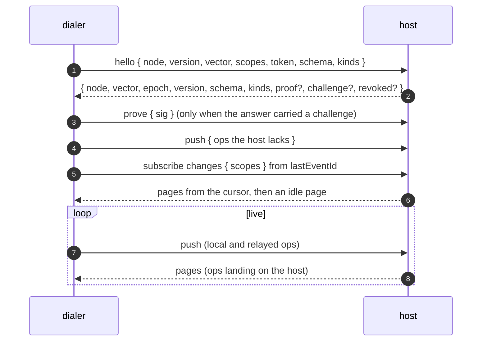

# Wire format

What travels between two nodes and what lies on disk, byte by byte: the op
and its twenty slots, the payload of every type, what a signature covers,
the per-stream chain, the log and record files, the procedures and the
events, the bounds a node holds a peer to, and what may change
without breaking a peer.
Every example on this page was run against the package as it is
(`@alexify/syncom/all` over `memory()`); node ids, signatures and digests
are shortened to fit. The concepts are in [The operation log](../guide/operation-log)
and [The sync protocol](../guide/sync-protocol); this page is the shape, the procedures, the
guarantees and the bounds.

## The op

Every write is one op, a plain JSON object:

```
{ origin, seq, ts, type, id?, scope?, data?, meta?, key?, value?, vector?, from?, v?, actor?, sig?, digest?, nonce?, msg?, prev? }
```

| Field | Type | Meaning |
| --- | --- | --- |
| `origin` | string | The node that made it — its Ed25519 public key (43 base64url characters, canonical last character; a point of small order or a y past the prime is no key — no one holds its private half — and an op signed under one is forged) when the node signs, else its `getId()` id; a stream name: 1 to 128 characters, no `@`, no control character |
| `seq` | integer ≥ 1 | Its sequence number on that origin, per scope: the vector key is `origin@scope` (`origin` alone for the global scope `*`), and the ops born of a snapshot run in `origin@~` |
| `ts` | integer ≥ 1 | `Date.now()` when made, never below a stamp the node had seen |
| `type` | string | One of the sixteen below |
| `id` | string | The record, `[A-Za-z0-9_@-][A-Za-z0-9._@-]{0,127}` — a file name on three platforms; every type but `advance` has one |
| `scope` | string | The record's scope as the writer read it; absent in the global scope |
| `data` | object | A `write`'s or `set`'s fields; the registers a `version` writes; a `merge`'s record data |
| `meta` | object | A `merge`'s metadata (the shape under [The record file](#the-record-file)) |
| `key` | string | A field op's field — a name, or a path of names joined by `/` (at most 16 segments, 512 characters) |
| `value` | any | A field op's argument, by type |
| `vector` | object | An `advance`'s version vector |
| `from` | string | The node whose snapshot a `merge`/`advance` joined — a claim, carried as is |
| `v` | integer ≥ 1 | The writer's schema version; absent without a schema and on `merge`/`advance`. On a `write` and a `version` it is the version the record is of from the op's stamp on |
| `actor` | string | Who made it, as the writer claims — signed, never verified |
| `sig` | string | 86 base64url characters: the Ed25519 signature of the [header](#what-a-signature-covers) |
| `digest` | string | 43 base64url characters (canonical last character): SHA-256 of the nonce and the canonical payload |
| `nonce` | string | 16 to 64 base64url characters (a UUID, as written); gone with the payload when the op is scrubbed |
| `msg` | string | A transaction's message, at most 1 024 characters, on every op of the transaction, signed |
| `prev` | string | 43 base64url characters: the [fingerprint](#the-per-stream-chain) of the op before it in its stream, signed; absent on a stream's first op, and where the writer holds no op before it |

`origin`, `seq`, `ts`, `type`, `scope`, `v`, `id` (or an `advance`'s
`vector`), `sig`, `digest`, `nonce`, `msg` and `prev` are checked by shape, and every
field by how deep it nests (80 levels, `MAX_WIRE_DEPTH`), before a peer's op
is read at all — its signature included (`wellFormed` in `src/shape.js`); one
that fails is `malformed` — counted, not logged, not relayed, a gap in its
stream. A stamp more than `sync.maxSkew` (24 hours) ahead of the receiver's
clock — the op's `ts`, or any stamp a `merge`'s `meta` holds — is refused the
same way (`SKEW`). The payload fields are checked where they land: an op the
engine does not admit changes nothing, is reported as `OP_REFUSED` with
`reason: 'malformed'`, and is still logged and relayed.

### Types and payloads

| `type` | Code | Carries | Payload |
| --- | --- | --- | --- |
| `write` | `w` | `data` | The whole record; fields not written are gone |
| `set` | `s` | `data` | The fields to set; last writer wins per field by `(ts, origin)` |
| `unset` | `u` | `value` | `string[]` — the fields to remove, as names or paths |
| `version` | `v` | `value?`, `data?` | The record is of the op's `v` from its stamp on: last writer wins among the `write`s and the `version`s of a record, by stamp alone (see `v` under [The record file](#the-record-file)). With it, at the same stamp: `value`, the fields removed as an `unset` removes them, then `data`, the registers set as a `set` sets them — nothing else of the record is reset. What a migration makes: the names the lens removed, the registers it wrote |
| `inc` | `i` | `key`, `value` | A finite number to add to the counter |
| `add` | `+` | `key`, `value` | `unknown[]` — the elements to add to the set |
| `remove` | `-` | `key`, `value` | `[element, { origin: addStamp }][]` — each element with the add stamps this node had seen for it |
| `splice` | `/` | `key`, `value` | `{ cut?, at \| run + from, content, vals? }` — `run + from` extends the writer's own run (its stamp), never a move's position run (malformed); names and anchors below the table |
| `assign` | `=` | `key`, `value` | `{ elem, value, k? }` — `k: 't'` when the element is a text's embed slot |
| `move` | `^` | `key`, `value` | `{ elem, cut, at, value }` |
| `mark` | `*` | `key`, `value` | `{ start, end, key, value, many? }` or `{ off }` |
| `tree` | `~` | `key`, `value` | `{ node, parent, fi }` — `parent` `null` at the root, `$trash` removed; `fi` a fractional index |
| `delete` | `d` | `data?` | A tombstone. Delete wins: an op of a field stamped above it lands in the meta and keeps nothing alive; only a newer `write` revives the record. `data`, when given, is a plain object whose fields lie on the tombstone at its stamp, the record as dead as without them; a reader of the tombstone (a `change`, a snapshot page) reads them |
| `purge` | `p` | — | Wins at any stamp; every entry of the id is scrubbed |
| `merge` | `m` | `data`, `meta`, `from` | A snapshot record joined |
| `advance` | `a` | `vector`, `from` | Which ops the joined state covers |

Which call makes which type: `insert()`, `set()` and `saveData()` a `write`;
`update()`, `swap()` and a document's `save()` a `set`; `unset()` an `unset`;
`inc()` an `inc`; `add()` and `remove()` an `add` and a `remove` (a remove of
an element this node never saw added makes no op); `splice()`, `push()` and
`updateText()` a `splice`; `setAt()` an `assign`; `move()` a `move`; `mark()`,
`unmark()` and `unmarkById()` a `mark`; `treeMove()` and `treeRemove()` a
`tree`; `delete()` a `delete`; `purge()` a `purge`; a snapshot page being
joined a `merge` per record and an `advance`. `applyPatches()`, `restore()`,
`compact()` and the undo stack write through these same ops. A `version` is
no call's own: a write of a field to a record of an older schema version
than the node's makes one first, in the write's transaction, and `migrate()`
one per record — followed by an `inc`, an `add`, a `splice` or the `tree`
moves of each counter, set, list, text or tree the lens renamed or rewrote —
and a `set` that makes a record (a patch on a record that is not there, a
state's first write) on a node whose schema version is above 1 goes as a
`version` carrying its fields, so the record says which version it is of.

The codes are the protocol's, not a plugin's: a node without the text or
tree plugin still reads, logs and relays a `/` or a `~`. A `version` has no
code: where an op travels packed, the slot of the type carries its name. One
op of each but a `version`, as it reads back from the log as `{ seq, op, fp }` — the file holds it
positional, see [The log](#the-log). The `write` and the `purge` of `p2` are
scrubbed: the payload and the nonce gone, the header and its signature kept.

```json
{"seq":1,"op":{"origin":"VLH7Ywu…","seq":1,"ts":1793087684840,"type":"write","id":"p1","v":1,"data":{"$type":"Post","title":"Draft","note":"tmp"},"nonce":"55b902dd-…","digest":"pNpYxfs6…","sig":"YE3frhE…"},"fp":"SmNVKTkH…"}
{"seq":2,"op":{"origin":"VLH7Ywu…","seq":2,"ts":1793087684846,"type":"set","id":"p1","v":1,"data":{"title":"Final"},"prev":"SmNVKTkH…","nonce":"1258f80d-…","digest":"CY61ahM3…","sig":"hEvgr7g…"},"fp":"3GmlODml…"}
{"seq":3,"op":{"origin":"VLH7Ywu…","seq":3,"ts":1793087684849,"type":"unset","id":"p1","v":1,"value":["note"],"prev":"3GmlODml…","nonce":"5813af09-…","digest":"aW5z0E8A…","sig":"1wiJRzm…"},"fp":"UuNQx9vT…"}
{"seq":4,"op":{"origin":"VLH7Ywu…","seq":4,"ts":1793087684852,"type":"inc","id":"p1","v":1,"key":"views","value":1,"prev":"UuNQx9vT…","nonce":"00a3ef68-…","digest":"4nQUrOQo…","sig":"se88RPf…"},"fp":"VY9jdnUE…"}
{"seq":5,"op":{"origin":"VLH7Ywu…","seq":5,"ts":1793087684855,"type":"add","id":"p1","v":1,"key":"tags","value":["bug"],"prev":"VY9jdnUE…","nonce":"3887133a-…","digest":"vDdi0F3k…","sig":"us6GHE9…"},"fp":"q49yF0IJ…"}
{"seq":6,"op":{"origin":"VLH7Ywu…","seq":6,"ts":1793087684858,"type":"remove","id":"p1","v":1,"key":"tags","value":[["bug",{"VLH7Ywu…":1793087684855}]],"prev":"q49yF0IJ…","nonce":"6556dcfe-…","digest":"SjDF-Rzq…","sig":"WXfaw6w…"},"fp":"9z2V-22e…"}
{"seq":7,"op":{"origin":"VLH7Ywu…","seq":7,"ts":1793087684861,"type":"splice","id":"p1","v":1,"key":"body","value":{"content":"hello","at":"^"},"prev":"9z2V-22e…","nonce":"0438623a-…","digest":"e8xPy71S…","sig":"fldcPee…"},"fp":"HEbXDRV7…"}
{"seq":8,"op":{"origin":"VLH7Ywu…","seq":8,"ts":1793087684866,"type":"splice","id":"p1","v":1,"key":"items","value":{"content":[1,2],"at":"^"},"prev":"HEbXDRV7…","nonce":"be90dd02-…","digest":"rRDJp_Dt…","sig":"IUE0qCZ…"},"fp":"guFO1EOS…"}
{"seq":9,"op":{"origin":"VLH7Ywu…","seq":9,"ts":1793087684869,"type":"assign","id":"p1","v":1,"key":"items","value":{"elem":"1793087684866:0","value":9},"prev":"guFO1EOS…","nonce":"94a8f651-…","digest":"lpwSpgyW…","sig":"LUGj4mI…"},"fp":"chF-Ks1c…"}
{"seq":10,"op":{"origin":"VLH7Ywu…","seq":10,"ts":1793087684872,"type":"move","id":"p1","v":1,"key":"items","value":{"elem":"1793087684866:0","cut":[1793087684866,0,1],"at":">1793087684866:1","value":9},"prev":"chF-Ks1c…","nonce":"a7e7a486-…","digest":"pn6qODgP…","sig":"3n9P52d…"},"fp":"MqBO8DgA…"}
{"seq":11,"op":{"origin":"VLH7Ywu…","seq":11,"ts":1793087684876,"type":"mark","id":"p1","v":1,"key":"body","value":{"start":"<1793087684861:0","end":"$","key":"bold","value":true},"prev":"MqBO8DgA…","nonce":"13602c95-…","digest":"aU9shwrn…","sig":"Njs14Zx…"},"fp":"HhhOhsgk…"}
{"seq":12,"op":{"origin":"VLH7Ywu…","seq":12,"ts":1793087684879,"type":"tree","id":"p1","v":1,"key":"outline","value":{"node":"n1","parent":null,"fi":"V"},"prev":"HhhOhsgk…","nonce":"a70b7608-…","digest":"jII5zyZ1…","sig":"DqM2boN…"},"fp":"7vowLgJ6…"}
{"seq":13,"op":{"origin":"VLH7Ywu…","seq":13,"ts":1793087684884,"type":"set","id":"p1","v":1,"actor":"ada","data":{"n":1},"msg":"one more","prev":"7vowLgJ6…","nonce":"7b4cf045-…","digest":"Y-MlFI9f…","sig":"YG0eHAr…"},"fp":"PjeIYmkg…"}
{"seq":14,"op":{"origin":"VLH7Ywu…","seq":14,"ts":1793087684887,"type":"delete","id":"p1","v":1,"prev":"PjeIYmkg…","sig":"yUCV5eu…"},"fp":"ATQP-EcP…"}
{"seq":15,"op":{"origin":"VLH7Ywu…","seq":15,"ts":1793087684890,"type":"write","id":"p2","v":1,"prev":"ATQP-EcP…","digest":"4mS7e6Hf…","sig":"-JJKGYi…"},"fp":"DtsVxUAd…","scrubbed":true}
{"seq":16,"op":{"origin":"VLH7Ywu…","seq":16,"ts":1793087684892,"type":"purge","id":"p2","v":1,"prev":"DtsVxUAd…","sig":"UkSuqji…"},"fp":"vP8rexFG…","scrubbed":true}
```

Each op names the fingerprint of the one before it (`prev`), and the log
keeps each op's own beside it (`fp`): the stream is a hash chain, whole
after the scrub — see [The per-stream chain](#the-per-stream-chain).

An element's name is `ts:offset:origin` — the run it was inserted in and
its offset there — and a run's `ts:origin`; an anchor is `^` (the head),
`$` (the end, in a mark), `>e` or `<e` (the right or left child of element
`e`); a cut is `[run, offset, length]`. What is the op's own origin's is
named without it, the header carrying it already: a run by its stamp, a
number (`run`, a cut's run, a mark's `off`), an element as `ts:offset` (one
colon; a full name has two, whatever the origin holds) — `<ts:offset` and
`>ts:offset` as anchors. A reader lays the op's `origin` back before the
engine reads it, so a short name never names another origin's run; a full
name of the op's own is read alike. A `remove`'s add stamp is the `ts`
of the `add` this node had seen, per origin.

### Packed: the twenty slots

A push and a `changes` page carry ops packed — one positional array per
op, the type as its code, `null`
for an absent field, no key names repeated per op:

| Slot | Field | Slot | Field | Slot | Field |
| --- | --- | --- | --- | --- | --- |
| 1 | `origin` | 7 | `data` | 13 | `v` |
| 2 | `seq` | 8 | `meta` | 14 | `actor` |
| 3 | `ts` | 9 | `key` | 15 | `sig` |
| 4 | `type` (code) | 10 | `value` | 16 | `digest` |
| 5 | `id` | 11 | `vector` | 17 | `nonce` |
| 6 | `scope` | 12 | `from` | 18 | `msg` |
| | | | | 19 | `prev` |
| | | | | 20 | `scrubbed` (`1`, or `2` withheld) |

The ops above, packed (`packOps` in `src/sync/wire.js`; `unpackOps` is the way
back, and takes a row of fewer than five slots as nothing):

```json
["VLH7Ywu…",1,1793087684840,"w","p1",null,{"$type":"Post","title":"Draft","note":"tmp"},null,null,null,null,null,1,null,"YE3frhE…","pNpYxfs6…","55b902dd-…",null,null]
["VLH7Ywu…",4,1793087684852,"i","p1",null,null,null,"views",1,null,null,1,null,"se88RPf…","4nQUrOQo…","00a3ef68-…",null,"UuNQx9vT…"]
["VLH7Ywu…",7,1793087684861,"/","p1",null,null,null,"body",{"content":"hello","at":"^"},null,null,1,null,"fldcPee…","e8xPy71S…","0438623a-…",null,"9z2V-22e…"]
["VLH7Ywu…",13,1793087684884,"s","p1",null,{"n":1},null,null,null,null,null,1,"ada","YG0eHAr…","Y-MlFI9f…","7b4cf045-…","one more","7vowLgJ6…"]
["VLH7Ywu…",14,1793087684887,"d","p1",null,null,null,null,null,null,null,1,null,"yUCV5eu…",null,null,null,"PjeIYmkg…"]
["VLH7Ywu…",16,1793087684892,"p","p2",null,null,null,null,null,null,null,1,null,"UkSuqji…",null,null,null,"DtsVxUAd…"]
```

Slots were appended in this order — `v` was the thirteenth, `actor` the
fourteenth, the signature's three the fifteenth to seventeenth, `msg` the
eighteenth, `prev` the nineteenth, `scrubbed` the twentieth — and are never
reordered: a reader of fewer slots ignores the rest, a reader of more takes
an absent slot as `null`. `scrubbed` is `1` on an op whose payload a purge
took (its id's entries, or an op that landed on a purged record), `2` on one
a rule withheld — its sender's `beforeSend`, a host's `authorizeWrite`, a host
that read the record as outside the pusher's scopes — and `null` otherwise: a
scrubbed op is a header alone, applied nowhere, logged and relayed as one. A
`purge` carries nothing a scrub could take, so under `1` it applies as it is
(a purge's own entry is scrubbed with the rest of its id and still purges
every node it reaches); under `2` it purges nothing either, so a purge a host
refused never reaches the nodes behind it. Read back, `2` is `scrubbed: true`
and `withheld: true` on the op (both in the log line's rest). The log itself
keeps the keyed form; packing is for the wire.

## What a signature covers

Every node links its own ops into their streams before the append (`prev`,
signing or not — `src/header.js`), and a signing node (the `signing` plugin,
registered by `@alexify/syncom/all`) signs them, in three parts:

1. **The payload** — `data`, `meta`, `key`, `value`, `vector`, whichever the
   op carries, as one object — serialized canonically (every object's keys
   sorted at every depth, `canonical` in `src/shape.js`), salted with a
   fresh `nonce` and hashed: `digest = sha256(nonce + "\n" + canonical)`
   (the hash of that text as a JSON string, as 43 base64url characters). An op without a payload (a
   `delete`, a `purge`) has no digest and no nonce.
2. **The header** — a positional JSON array under a version number, `null`
   for an absent field:
   `[1, origin, seq, ts, type, id, scope, from, v, actor, digest, msg, prev]`.
3. **The signature** — Ed25519 over the header's text, as 86 base64url
   characters in `sig`. The key is the origin: the node id *is* the public
   key.

The `set` op above, taken apart:

```
header     [1,"VLH7Ywu…",2,1793087684846,"set","p1",null,null,1,null,"CY61ahM3kCZRiP8NjcNFOKsUj8haWFXCsRxfU8zRjeI",null,"SmNVKTkHmv5uaHCQYAlseskUcAzpyIPphUrGPIcSbZc"]
canonical  {"data":{"title":"Final"}}
nonce      1258f80d-6064-41cb-8e78-cafc70f87074
digest     CY61ahM3kCZRiP8NjcNFOKsUj8haWFXCsRxfU8zRjeI
```

A receiver verifies before it applies: an origin that is no key, a payload
its digest does not match, a digest with no nonce, a nonce with no payload,
or a signature that does not verify is `forged` and a gap in the stream;
an unsigned op is taken under `sync.signatures: 'verify'` (the default) and
refused under `'require'`. The split is what lets a `purge` scrub the
payload and the nonce and leave an op whose header still verifies — the
`write` of `p2` above — and the nonce is what keeps a scrubbed digest from
giving a short payload away by brute force. A signature binds authorship,
content and the op's place in its stream to the origin's key through any
relay; it proves nothing about delivery, and `actor` stays the origin's
claim.

### Modes

`createDatabase({ sync: { signatures } })` picks what a node signs and what
it holds a peer's op to:

| Mode | This node | A peer's op with a signature | A peer's op without one |
| --- | --- | --- | --- |
| `'verify'` (default) | signs | verified; refused when it does not check | taken |
| `'require'` | signs | verified; refused when it does not check | refused — as is one whose origin is no key |
| `false` | signs nothing | taken, unverified | taken |
| without the `signing` plugin (`'verify'`) | signs nothing — its id is no key | taken, unverified | taken |

`'require'` without the plugin is refused at `createDatabase()`
(`PLUGIN_MISSING`): the mode has nothing to check with. A refused op is
counted (`forged`, `unsigned` in the apply result and the
`syncom.ops.rejected` metric) and reported once per page as an `error`
event (`BAD_SIGNATURE` or `UNSIGNED`, with the first refused op and the
`count`); it is neither logged nor relayed and the vector does not move, so
it is a gap for its stream until it comes again, intact. A host announces
the same through the `refused` event (`reason: 'forged' | 'unsigned'`), and
a `'require'` host refuses a `hello` from a node id that is no key (403
`UNSIGNED`). A signature is checked only after the op's shape, and a check
that throws is that op's `BAD_SIGNATURE`, never the page's failure.

What a signature leaves open: `actor` is signed, so no relay changes it,
but it is still the writer's claim about itself — a host that knows who a
peer is (what `authorize` established) holds it to the claim in
`beforeApply`. A snapshot carries records, not ops: a node that bootstraps
signs the joined state as `merge` and `advance` ops of its own, under its
own key, so under `'require'` a bootstrap is the one way unverified state
enters a node — from a host it chose, and `beforeBootstrap` let through.
Under `'verify'` a relay can strip a signature and the op is taken as an
unsigned one; only `'require'` on every node resists that. A peer can
withhold an op (a gap, which shows) or strip its payload and nonce and
present it as scrubbed or withheld, which applies as a no-op (withheld, a
purge too): suppression, not forgery.
A hub that runs `signatures: false` to spare itself the check still relays
the signatures intact, since the fields are opaque to it. Node.js verifies
on libuv's thread pool (`UV_THREADPOOL_SIZE`, four threads by default,
shared with file I/O and DNS), the browser in Web Crypto, 64 ops of a page
at a time; `bytesPerPush` counts the bytes the three fields add. The cost:
about a tenth of a millisecond of CPU per op verified, some tens of
microseconds per op signed, and some 190 bytes per op on the wire and in
the log.

## The per-stream chain

An op's **fingerprint** is the SHA-256 of its header's text, as 43 base64url
characters — `fp` of the `set` above is `3GmlODml…`. It is the same on
every node, signing or not, and whole after a scrub: the header keeps the
digest. A signed op's header carries the digest, so its fingerprint covers
the payload too; an unsigned op's covers the header alone — its stamp, seq,
type and record — so two unsigned ops that differ in payload alone are one
op to it. Every op names the fingerprint of the op before it in its
**stream** (`origin`, `origin@scope`, or `origin@~` for the `merge` and
`advance` ops a bootstrap makes) as `prev` — the `set`'s `prev` is the
`write`'s fingerprint, `SmNVKTkH…` — so a fingerprint covers the whole
stream up to its op: a hash chain per stream, under the signature. A
stream's first op names none, and so does an op whose writer holds no op
at the seq before it.

A node keeps the fingerprint of every op its log retains (`fp`, beside the
op) and, per stream, of the newest op it ever held (`heads` in the
[index](#the-log)), and holds what it is handed to them, after the shape and
the signature:

| A peer's op | Verdict |
| --- | --- |
| at a seq this node holds, with another fingerprint | `EQUIVOCATION`, `reason: 'seq'` |
| the next of its stream, naming another `prev` than the fingerprint held at the seq before it — or none, when it is signed | `EQUIVOCATION`, `reason: 'chain'` |
| the next of its stream, unsigned and naming none — a hand-made op, an older writer's | taken |
| the next of its stream where this node holds no op before it — the stream starts there, or this node joined it by a [snapshot](#snapshot) | taken; the chain is held from it |

An op refused as `EQUIVOCATION` is neither logged nor relayed and the vector
does not move: like a forged op, it is a gap for its stream. It is counted
(`equivocations` in the apply result, `syncom.ops.rejected` with `reason`
`equivocation` or `chain`) and reported once per page — the storage's
`error` event with the op, `origin`, `scope`, `seq`, `reason`, `held` (the
fingerprint this node holds: at the op's seq, or at the one before it) and
`received` (the op's own, or the `prev` it names), and `count`.

What it gives: a writer that made two ops at one seq — a directory restored
from an older copy, a second instance under one identity, a key holder that
lies — is caught at the first node that holds one and is handed the other,
or the next op of the other branch; each node keeps the branch it took
first, and none mixes the two. Under signatures `prev` cannot be changed or
stripped (the op is then `forged`). What it does not: heal the fork — the
nodes that took different branches stay apart, and report it every time they
meet — or check what a node never held: a node that joined a stream by a
snapshot takes its next op as given.

## The log

Under `<path>/log/`, over the backend's functions — whole-file reads and
writes, and `append` for a journal where the backend has it; the index and
the segments are written `atomic` (a temporary file renamed into place on
`node:fs`), a journal rewritten under a new name, never in place:

| File | Holds |
| --- | --- |
| `open/<seq>-<token>.jsonl` | A journal, where the backend has `append`: one log file per line, a line per group of appends; named by its first seq (ten digits zero-padded) and a token unique to the open and the journal; begun again at every roll and after a failed append, removed once every group in it is sealed, rewritten only by a scrub |
| `open/<seq>.json` | A group in a file of its own, where the backend has no `append`; named by its first seq |
| `seg-<from>.json` | A sealed segment: the open groups rolled together once 64 of them accumulate (`log.rollAfter`) — their lines as they were journaled, one per line, then a trailer `{"lines":<n>,"to":<last seq>,"c":"<crc32>"}`, `c` the CRC-32 of the lines' checksums one after another |
| `index.json` | `{ epoch, floor, next, vector, heads, droppedHeld, latestTs, droppedTs }` — what the files cannot say: the epoch, the floor, and the vector, heads and stamps of what compaction dropped; written where compaction dropped something and at a close, not at every roll. The segments are what the directory lists, each read whole; one whose start does not meet the floor or the end of the one before is a file gone (`log.segment.missing`), one wholly below the floor was compacted and is removed |

Every log file is `{"e":[…],"c":"<crc32>"}` — the entries as a JSON array
and the CRC-32 (IEEE, zlib's) of that array's text as eight lowercase hex
characters, last, so it is checked before the entries are parsed. A file
whose checksum does not match is unreadable at open
(`log.segment.unreadable`, `reason: 'checksum'`, counted in
`stats().log.corrupt`, its entries lost — `droppedTs`); an open group file
that fails its checksum was whole once, so it is moved to `log/corrupt/`
as the evidence, never deleted; one that does not parse was torn by its
own write, never acknowledged, and is dropped (`log.open.torn`). A file
that reads as JSON without its checksum is not whole: unreadable, as one
that fails it. A file that is there and cannot be read at all — an I/O
error, not a missing file — fails `createDatabase()` with `CORRUPT`: an open that went
on without it could hand its seqs out again.

A segment is read whole or not at all: every line checks on its own, and
the trailer holds as many lines as there are, the last seq of the last one
and the checksum of their checksums — a line altered, gone or moved, or the
trailer gone, makes the segment unreadable (`reason: 'checksum'`). A segment
a scrub rewrites is its entries as one line and a trailer.

A journal is read line by line, each line a log file of its own. Its last
line is the one a crash can tear — its group was never acknowledged — and is
left out (`log.open.torn`); a line before it that does not read was
acknowledged once and is lost (`log.open.unreadable`, counted in `droppedTs`).
The open files are read newest name first, and the first copy of a seq read
is the one kept: a group whose append failed after its line landed gave its
seqs back, and the group that took them went to a newer journal. A later open
never appends to an older journal.

```json
{"e":[[2,"9RVv-fuAXZzHa1Pb8qvUNpa1JCBq7OPS8oRQZStR6Uk",[1,"SpxoiDvaETq5phZnW8xiqFUuHuE02PEwU7zVbyZlTRg",2,1793444749744,"set","p1",null,null,null,null,"qqIkTnQuk3S5qeXhLcc2wSgl7PsP5B3y1-aLzm1K8SI",null,"9_aH1aS-vwzSwjXB-g57rcERIjDHzxAEPU6zzY_jJBg"],{"data":{"title":"Final"}},{"nonce":"a5bb053f-fa0c-4155-bc45-d81e1834958c","sig":"2EjzE9cMqvxyZwbyjyh9-7xr6TV9yTuOvvKAt38Dly6YOpx-2R1tqR9rvUM2ZdGSe6lT-6CAEX1RRF4fMCokDQ"}]],"c":"3e6ee2cb"}
```

An entry is `[seq, fp, header, payload, rest?, flags?]` — `fp` the op's
[fingerprint](#the-per-stream-chain), taken when it was logged (null when
none was); `header` the op's [signed header](#what-a-signature-covers), the very
text its fingerprint hashed (a field the op lacks is null there and absent
again once read); `payload` its `data`, `meta`, `key`, `value` and `vector`
(null for none); `rest` what else the op carries — its `sig` and `nonce` —
and `flags` the entry's: `skipped: true` for a peer's op a `beforeApply`
hook or a validator declined (accepted into the log, never applied here, so
a reopen does not apply it either), `held: <version>` for an op of a newer
schema version kept for the node that runs it, and `scrubbed: true` once a
purge took its payload. The last two are left out when empty (`rest` is null
where only `flags` are there). Read back, an entry is `{ seq, op, fp }` and
its flags again. An entry without `fp` is
read; its op is then nothing a chain is held to. The index after a clean
close, with the sixteen ops sealed into one segment — `heads` the stream's
newest op and its fingerprint, kept once the op itself is compacted away:

```json
{"epoch":"mvqe40dinmi2cx","floor":1,"next":17,"vector":{"VLH7Ywu…":16},"heads":{"VLH7Ywu…":[16,"vP8rexFGNozvq4vFd4wYEitJ9-7aoVUnJYyLenq1g8o"]},"droppedHeld":0,"latestTs":1793087684892,"droppedTs":0}
```

An **event id** is `<epoch>.<seq>` — `mvqe40dinmi2cx.16` — the epoch
minted once when the log is created, so a cursor from a wiped or restored
directory is told to bootstrap rather than fed a coincidence. `floor` is
the lowest seq retained: below it, or under another epoch, a resume is
refused. The log keeps at least `sync.retention.ops` ops (10 000; `'all'`
keeps everything) and drops whole segments from the front past that, while
its own unacknowledged ops and the segments a reader pins stay.

## In an engine

A native engine keeps what the files above hold in its own stores, every key beginning with the database's path `p`,
so one medium serves many databases and `engine.remove(path)` is a range delete. The record is the file's object
(IndexedDB: the structured clone; SQLite and MongoDB: its JSON text), a log entry the `{ seq, op, fp, … }` object the
log holds (a text where the medium stores texts), the log's `index.json` a value of `meta`, the sealed segments a list
`[{ from, to, count }]` beside it — no journals, no trailers, no checksums: the medium's transaction is the unit that is
whole or nothing.

| Store | IndexedDB (`idbEngine`) | SQLite (`sqliteEngine`) | MongoDB (`mongoEngine`) |
| --- | --- | --- | --- |
| `kv` | `[p, ns, key]` → `{ value }` | `kv (p, ns, key, value)` | `kv { _id: JSON [p, ns, key], p, ns, key, v }` |
| `records` | `[p, id]` → `{ stored }` (or `{ text }`) | `records (p, id, text)` | `records { _id: JSON [p, id], p, id, t, w }` |
| `pieces` | `[p, id, name]` → `{ text }` | `pieces (p, id, name, text)` | `pieces { _id: JSON [p, id, name], p, id, name, t }` |
| `copies` | `[p, tag, id]` → `{ text }` | `copies (p, tag, id, text)` | `copies { _id: JSON [p, tag, id], p, tag, id, t }` |
| `log` | `[p, seq]` → `{ entry, first }` | `log (p, seq, first, entry)` | `log { _id: JSON [p, seq], p, seq, first, last, e, w }` |
| `meta` | `[p, key]` → `{ value }` (`index`, `segments`, `catalog`) | `meta (p, key, value)` (`index`, `segments`) | `meta { _id: JSON [p, key], p, key, v }` (`index`, `segments`); `locks { _id: p, owner, expires }` |

`first` is the first seq of the entry's group — what a reopen rebuilds the open groups from; `last` (MongoDB) the
group's last, so a reopen tells a group short of its documents (never acknowledged) from a whole one — every group's
bulk write wipes the documents at or past its first seq first; `w` the writer's token
(MongoDB), what tells a change stream another instance's writes from this one's. Under `atRest(engine)` every value
above is `enc1:` ciphertext bound to its place (`data/<id>.json`, `log/<seq>`, `log/index.json`…), the keys and the
index's `floor` in the clear. These layouts are unpublished and free to change until the first release.

## The record file

`<path>/data/<id>.json`, written after the append (or within `defer`
milliseconds of it, 16 by default):

```json
{"data":{"title":"Final","$type":"Post","views":1,"tags":[],"body":"hello","items":[2,9],"outline":[{"id":"n1","children":[]}],"n":1},
 "meta":{"clock":{"title":[1792951855656,"VTwt7hZ…"],"$type":[1792951855653,"VTwt7hZ…"],"n":[1792951855667,"VTwt7hZ…"]},
         "base":[1792951855653,"VTwt7hZ…"],"deleted":null,
         "counters":{"views":{"VTwt7hZ…":[4,1,1792951855658]}},
         "sets":{"tags":{"\"bug\"":{"VTwt7hZ…":[1792951855659,1792951855659]}}},
         "blocks":{"body":{"k":"t","ts":1792951855665,"runs":{"1792951855661:VTwt7hZ…":["^",["hello"]]},"marks":{"1792951855665:VTwt7hZ…":["<1792951855661:0:VTwt7hZ…","$","bold",true,0]}},
                   "items":{"k":"l","ts":1792951855664,"runs":{"1792951855662:VTwt7hZ…":["^",[1,[2]]],"1792951855664:VTwt7hZ…":[">1792951855662:1:VTwt7hZ…",[[9]],"1792951855662:0:VTwt7hZ…"]},"pos":{"1792951855662:0:VTwt7hZ…":[1792951855664,"VTwt7hZ…","1792951855664:VTwt7hZ…"]},"vals":{"1792951855662:0:VTwt7hZ…":[1792951855663,"VTwt7hZ…",9]}},
                   "outline":{"k":"tree","ts":1792951855666,"moves":{"n1":[[1792951855666,"VTwt7hZ…",null,"V"]]}}},
         "gone":{"note":[1792951855657,"VTwt7hZ…"]},"v":1,"vs":[1792951855653,"VTwt7hZ…"]},
 "encrypted":false,"timestamp":1792951855665,"block":"16219399…"}
```

`data` is the record as the op model reads it — a counter as its sum, a
set as its sorted elements, a text as its string, a list as its array, a
tree as nested `{ id, data?, children }` — and `meta` is what makes it
merge:

| `meta` | Shape |
| --- | --- |
| `clock` | Per register field, its stamp `[ts, origin]` |
| `base` | The record's reset watermark: the stamp of its last whole-record write, delete or purge |
| `deleted` | The tombstone's stamp while the newest reset is a delete, else `null`: the record reads as gone while it is set, whatever the other maps hold above it (delete wins) |
| `purged` | The purge's stamp, once purged — nothing but another purge or a merge lands after it |
| `counters` | Per field, per stream — the op's vector key, `origin` or `origin@scope`, since seqs run per stream — `[seq, sum, ts]`: the stream's running sum, within ±2⁵³; a slot keyed by the bare origin is the global stream's |
| `sets` | Per field, per element (its canonical JSON as the key), per origin, `[added, removed]` stamps; live while `added > removed` |
| `blocks` | Per list, text or tree field, the kind plugin's block under its code `k` — `t` text, `l` list, `tree` — with the block's `ts`; a text's or list's `runs` (`[anchor, content, extendedFrom?]` per `ts:origin`), `cuts`, `ext`, `pos`, `vals`, `marks`, `pending`; a tree's `moves` (`[ts, origin, parent, fi]` per node) |
| `gone` | Per field removed by `unset`, the stamp of the removal — a register's tombstone an older `set` loses to |
| `v` | The schema version the record is of: the `v` of the newest op that said one — a whole-record `write`, or a `version` — absent where none did (read as 1). A field op and a `delete` leave it; a `write` without a `v` says none. A node's local field op on a record of an older version than its own migrates the record first (a `version` at its version carrying what the lens changed, then the op, one transaction) |
| `vs` | The stamp of the op that decided `v`, present with it. Last writer wins by this stamp alone, never by `base`, so the version is the same whatever order the ops arrive in: a `write` of an older version stamped above a migration makes the record that version again, one stamped below it does not. A snapshot join takes the pair with the newer `vs`; a `purge` takes both away |

A list or text block of 1 024 runs or more (`PIECES_MIN`) is written in
**pieces**: its `runs` leave the record file for files beside it,
`<id>~<n>.json`, each 512 runs (`PIECE_RUNS`) by the order this node first
named them (`src/text/state.js`) — the oldest first, what an op makes in the
newest — and the block names them in their order, a slot each, `null` where
none:

```json
"body":{"k":"t","ts":1793090489785,"parts":["p1~3.json","p1~17.json",null,"p1~9.json"]}
```

and the record file carries `"gen"`, the counter `n` runs on. A write
makes the file of a piece one of whose runs reads otherwise — made, grown
or cut; a local insert grows a run of the newest piece alone, so a
keystroke anywhere is the newest piece — then the record file, then removes the
pieces it no longer names: a crash leaves the old record file whole with
its pieces, or the new one with its. New pieces a crash left unnamed are
written over as `n` reaches them again; old ones it left after the record
file stay on disk, never read. A read assembles the block whole
(a piece gone is `INTEGRITY`); a tag's copy of a record is whole, never
in pieces.

A peer's `meta` is never trusted as it comes: a snapshot's is rebuilt into
this shape key by key (`normalizeMeta` in `src/ops.js`), own keys only,
each block through its plugin under the node's bounds, anything else
dropped. The block layouts are the headers of `src/text/sequence.js` and
`src/tree/moves.js`.

`block` names the chain block that committed the write, when the `chain`
plugin runs: under `<path>/blockchain/`, each block is `{ prev, timestamp,
data }` in a file named by its sha256, `prev` the hash of the block before
it (`'0'` for the first), `data` the record's id and the sha256 of its data
as written and `from`, the op's event id (a peer's batch names every record
it touched), and `.blockchain.json` holds `{ tailHash }`:

```json
{"prev":"4eaa96b4…","timestamp":1792951855843,"data":{"id":"p1","hash":"44136fa3…","from":"mvo58q1gu75ziu.14"}}
```

A cold read of a record file is checked against its block; a mismatch is
an integrity failure, never repaired on read.

The rest of a directory: `node.json` `{ id, plugins }` (the node's id and
the kind plugins it was opened with), `keys/sign-public.pem` and
`keys/sign-private.pem` (the Ed25519 pair the id is), `keys/public.pem` and
`keys/private.pem` (the RSA pair that seals an encrypted record),
`schema.json`, `lock.json`, `index/catalog.json` (`{ format: 1, indexes,
stamp, rows }` — derived, rebuilt when stale; a row is `[id, type, v, encrypted, fields, gone, seventh]`, cut after
its last cell that says something: the seventh a live record's search text, or the stamp of a tombstone's delete —
a folded tombstone lives whole in the `tombstones` kv namespace, see [cleanup](../guide/cleanup)), `local/` (the
local documents), `pipeline/` (the pipelines' checkpoints), `tags/`, `blobs/<digest>` (an attachment's bytes under
their SHA-256, base64 text in the files engine), and the texts a block keeps in the root namespace or one of its own:
`revoked.json` `{ v: 1, nodes: { "<node>": ["<scope>", …] } }` (the scopes a host took back from each node,
[revoke](#the-revoke-event)), `uploads.json` `{ v: 1, nodes: { "<url>": [["<digest>", "<id>", "<name>"], …] } }` (the
attachments each dialed node still waits for the bytes of, oldest first — [`blobPut`](#blobput)), `shared/cursor.json` (a hub's cursors over the [shared log](#the-shared-log)),
`connector/<name>` `{ pull, pushed, known: { "<id>": "<22 base64url characters of the SHA-256>" | null }, refused: ["<id>"] }`
(a connector's checkpoint: the backend's position, this node's log position pushed through, the backend's state per
record as a digest, the ids whose state the database refused to land — [connectors](../guide/connectors)), `moved.json` `{ to: { path, engine }, at }` (a
source `rotateAtRest` copied away, fenced: `createDatabase` refuses it as `MOVED`) and `copy.json` `{ from, started }`
(a copy in flight into this directory, removed last; one left behind by a crash is taken away by the next copy).

## The procedures

A host mounts `storage.sync.unit()` as a wrpc router unit named `syncom`;
a dialer calls `syncom/hello`, `syncom/push`, `syncom/snapshot` and
subscribes to `syncom/changes`. Arguments and answers are JSON. A refusal
is an error with a numeric `code` (what wrpc carries) and a `reason`
naming the check.

| Procedure | Direction | Purpose |
| --- | --- | --- |
| `hello` | dialer → host | Node ids, vectors, the log's epoch, schemas, kinds and the protocol version, both ways; the host's `authorize` |
| `prove` | dialer → host | The challenge hello handed the dialer, signed under its key — first, where the host asks (`unit({ prove })`) |
| `push` | dialer → host | Ops the host lacks, by its vector, a page at a time |
| `changes` | host → dialer | A subscription: what lands in the host's log from the cursor on, live, an idle page once read to its end |
| `snapshot` | dialer → host | One page of the host's records, for a bootstrap |
| `blob` | dialer → host | An attachment's bytes by digest |
| `query`, `count` | caller → host | A thin client's read of the host's records in its scopes (`unit({ query: true })`) |

`push`, `snapshot`, `changes`, `query`, `count` and `blob` from a client
that has not said hello on this connection are 428 `HELLO_FIRST` — the
ordinary course of a wrpc reconnect, whose restored subscription reaches a
new server-side client: the dialer greets again. A unit that does not serve
a procedure (`unit({ allow })`) refuses it with 403: `READ_ONLY` for a push,
`NOT_SERVED` for a snapshot, a feed or a blob; a host without `query`
mounts no `query` or `count` (wrpc answers Not Found).



### `hello`

```
→ { node, version: 1, vector, scopes, token?, schema, kinds }
← { node, vector, epoch, version: 1, schema, kinds, duplicate?, proof?, challenge?, revoked? }
```

`challenge` is there when the host asks for a proof of the key (`unit({ prove })`,
on by default under `signatures: 'require'`): 32 random bytes as base64url,
to be signed under the caller's key and answered with `prove` before
anything else is taken or handed. `revoked` names the scopes the host took
back from this node (`sync.revoke`): asked for again, they are not granted.

`vector` is the caller's whole version vector; `scopes` the scopes it
asks to be held to (`['*']` for all); `token` its registered credential,
for the host's `authorize`; `schema` `{ version, hash }` or `null`; `kinds`
the names of the kind plugins it runs.

Over a [shared log](#the-shared-log) `epoch` is the log's
(`shared:<topic>`), the same on every hub, so a client moved between hubs
keeps its cursor; and a hub that cannot write — a follower, a writer whose
lease was lost — answers the `vector` as the log moved it, not its own as of
its open.

`proof` is there only when the caller's node id is a signing key and the
host's `vector` holds more of one of the caller's own streams (`node`,
`node@scope`, `node@~`) than the caller's `vector` says — a directory
restored from an older copy. It is the newest op of each such stream the
host's log still retains, packed in the [twenty slots](#packed-the-twenty-slots):
the caller's own op at the seq the host claims, signed by the caller's key.
The caller moves a stream past the host's (`REWOUND`) only when that op is
well formed, its origin, stream and seq are the claim's and its signature
verifies under the caller's own key — or under `sync.rewind: 'adopt'`
without it. A host can claim, never prove, what it did not receive. A proven
op's fingerprint is the stream's head from then on: what the caller's next
op of it names as `prev`. The answer, from the run above:

```json
{"node":"VLH7Ywu…","vector":{"VLH7Ywu…":16},"epoch":"mvqe40dinmi2cx","version":1,"schema":{"version":1,"hash":null},"kinds":["text","tree"]}
```

| Code | `reason` | When |
| --- | --- | --- |
| 400 | `BAD_HELLO` | No `node` |
| 400 | `PROTOCOL` | `version` is not this host's |
| 409 | `SELF` | The caller's node id is the host's — a copied directory |
| 403 | `UNSIGNED` | The host requires signatures and the node id is no key |
| 403 | `UNAUTHORIZED` | `authorize(context, hello)` said no |
| 400 | `BAD_HELLO` | More than 256 scopes asked for |

A refused hello reaches the dialer's `error` event with the code and is kept
as `peers()[i].lastError`; the host is greeted again when the link
reconnects, or after `enableNode(url, false)` and `true`. An answer without
a node id is the dialer's `BAD_HELLO`. `schema` both ways is `{ version, hash }`
— the node's schema version and the hash of its snapshot — or `null`; the
host's `authorize` sees the dialer's, the dialer keeps the host's as
`listNodes()[i].remote.schema`, and the `peer` and `hello` events carry it.
The same version with another hash on the far side is **drift** (two builds
of one schema that disagree): both sides emit `schema` `{ kind: 'drift',
peer, version, hash, local }` on the database, log a warning, and keep the
link up. Another version is not drift; it is what `v` on the ops is for.
`kinds` is what a bootstrap checks (see [`snapshot`](#snapshot)). A host
that answers 428 to five fresh hellos in a row is reported once as
`HANDSHAKE_LOOP` and not greeted again until the link reconnects.

### `push`

```
→ { ops: [packed…] }
← { vector, applied, skipped, duplicates, gaps, malformed, unsigned, forged, outOfScope, equivocations, refused }
```

`refused` names the ops the host refused and took — `{ origin, seq, scope,
id, actor, reason, current?, kinds? }`, `actor` the op's own (null for none) and
`reason` why: `'rule'` for its `authorizeWrite`, with `current` the record as
the host holds it (null for none) and `kinds`, `{ field: kind }` for its fields
that are no registers (absent where every field is one: a reading does not
tell a counter's sum from a number); `'scope'` for a record the host reads as
outside the pusher's scopes, without `current` (handing the record over would
be a read outside the grant). Each is logged there as a withheld scrub
(skipped, scrubbed, slot 20 `2`) and relayed as a no-op, so the stream has no
gap. The pusher reports each (`WRITE_REFUSED`, with the `reason`) and sets
itself straight after a rule's refusal of its own op: the fields the op
touched brought back to `current` through the kinds' own ops — each made the
kind `kinds` says, a field of another kind here unset and made again — or the
record forgotten where the host holds nothing; an op whose `actor` is `revert` is
reported and reverted no further. A refusal of scope is reported alone.

`vector` carries the keys the page touched, not the host's whole vector.
An op that declares a scope hello did not grant is refused before anything
reads it (`outOfScope`, not logged: a stream the peer may not write here);
one whose record the host reads as outside the grant is counted in
`outOfScope` too and taken as a withheld scrub (`refused`, `reason:
'scope'`); one that [equivocates](#the-per-stream-chain) is refused
(`equivocations`, the host's `refused` event with `reason: 'equivocation'`).
A hub that cannot write and has a [shared log](#the-shared-log) with an
inbox verifies the page as a writer would (`forged`, `unsigned` counted and
announced, never forwarded) and answers `forwarded: true` beside the counts:
the ops in order of their streams went to the inbox for a hub that writes to
land under its `authorizeWrite`, `vector` moved past them, a duplicate or a
gap by the vector the log keeps current — and by what was forwarded before
and the topic has not shown yet — counted and not forwarded. The hub's own
vector moves once the topic shows an op; what the writer did not take of an
inbox entry it names in the topic (`dropped`), and the hold is let go. The
attachments a forwarded page names are remembered for the node that pushed
it, 30 s and 1 024 a node: a [`blobPut`](#blobput) of one answers "not yet"
until the hub hears the record.

| Code | `reason` | When |
| --- | --- | --- |
| 428 | `HELLO_FIRST` | No hello on this connection — the ordinary course of a reconnect |
| 413 | `OPS_PER_PUSH` / `BYTES_PER_PUSH` | Over `unit({ limits })` |
| 429 | `OPS_PER_SECOND` | The peer's token bucket is empty |
| 403 | `READ_ONLY` | The unit takes no pushes (`allow.push` false) |
| 403 | `UNPROVEN` | The host asked for a proof of the key and has none yet |
| 503 | `READ_ONLY` | A hub that cannot write and forwards nothing — push to another |

### `prove`

```
→ { sig }
← { proven: true }
```

The `challenge` hello answered, signed under the caller's key as
`Ed25519( JSON([1, "prove", challenge, hostNodeId, callerNodeId]) )`, base64url.
Until it is answered `push`, `blobPut`, `snapshot`, `changes`, `query`, `count` and `blob` are 403 `UNPROVEN`, a presence
update is refused (`PRESENCE_UNPROVEN`), and the caller joins no room and is handed no presence; a
signature over another message or under another key is 403 `BAD_PROOF`, a call
without one (or without a challenge pending) 400 `BAD_PROOF`. Every hello is a
new challenge.

### `blobPut`

```
→ { digest, id, name }                 (a probe)
← { digest, have, stream }
→ { digest, id, name, stream, size }   (the bytes, as a stream of the transport's)
→ { digest, id, name, base64 }         (the bytes, where the link carries no stream)
← { digest, have }
```

The bytes of an attachment whose entry the caller pushed, uploaded to the host after a push it took, so a node
behind the host reads them there ([Attachments](../guide/attachments#attach-on-a-node-that-dials-a-server)). The
host takes them only where a live record in the caller's scopes names the digest under that name — the same door
as `blob`'s: a record forgotten, purged, sealed, out of scope, or naming another digest is one answer, 404
`NOT_NAMED`, so nothing is told — and only when their SHA-256 is the digest (400 `BLOB_MISMATCH`). Without bytes
the call is a probe: `have` says whether the host holds them, so they cross once, and `stream` whether this
connection carries a binary stream (a persistent, binary transport); with them the host keeps them and answers
`have: true` (also when it held them already — before a byte is read). Kept, the bytes go on to the hosts this host
pushed the entry to, the same way.

**The bytes cross as bytes.** Where the probe said `stream: true` and the link has `createStream`, the caller
announces a stream of the transport's (a wrpc binary stream — the link's [`createStream`](#the-link-contract)) of `size` bytes, sends the call naming it
(`stream` its id) at once, and writes the bytes into it with the writable's `writeAll`: chunks of 64 KiB, each as
the transport takes it. An empty blob is a stream of no bytes like any other. The host reads the chunks as they
land, `size` bytes and no further, and answers when it has them; it lets go of the stream whatever it answers
(`readable.terminate()`), which wrpc 2.1 tells the caller, whose writer stops: a refusal, or bytes the host held
already, leaves the rest unsent and nothing waiting. No message holds the whole blob, so a transport's message
limit (16 MiB on most of wrpc's engines) does not bound an attachment, and nothing is encoded. `base64` in the call
is the form for a link without streams (a text-only transport such as SSE, an in-process link); there the
transport's message limit bounds the attachment (10 MiB of body over wrpc's HTTP, a third of it lost to the
encoding).

Past `limits.bytesPerBlob` it is 413 `BYTES_PER_BLOB`, past 64 MiB (`MAX_BLOB_BYTES`, the one cap) 413
`BLOB_TOO_LARGE` — told by the `size` announced, or by the text's length, before a byte is read or decoded; 400
`BAD_DIGEST` for what is no digest; 400 `BAD_BLOB` for bytes that are no base64 text, for `stream` and `base64`
together, a `size` that is no non-negative integer, a stream this connection did not announce (or cannot carry), and a
stream that ended short of its `size` or ran past it; 403 `READ_ONLY` where the unit takes no pushes (`allow.push`
false) and on a hub whose lease was lost, 403 `NOT_SERVED` on a host without a blobs store; 428 `HELLO_FIRST` before
a hello, 403 `UNPROVEN` under `prove`.

**A hub that cannot write** is one of two. A follower (`readOnly: true`) opens over a shared engine alone, so its
blobs store is the one its writer reads: it takes the bytes through this same door — the record that names them,
the limits, the digest — and keeps them in that store. A blob is content-addressed and outside every write set, so
no lock is held and no op made. The record reaches a follower later than the push it forwarded, so the door is
shut right after the push; for a register the caller itself pushed through this hub the answer is then 425
`NOT_YET` rather than 404, for 30 s after the forward (the hub's memory of what it forwarded, 1 024 registers a
node, lost with the process). Every other miss — another node asking, another name, another digest, a register
this hub did not forward, one the writer did not land in that time — stays the one 404. A follower so writes a blob
only where its writer holds the record that names it, and what it kept it tells the writer through the inbox (the
[`landed`](#the-shared-log) entry), whose manager sends the bytes on to the hosts it dials. A hub whose lease was
lost is no follower: it writes nothing more, a blob neither, and says so for good — 403 `READ_ONLY`.

The dialer keeps, per host, the attachments a page the host took names (every `_attachments/<name>` entry a
pushed op sets, by digest, 1 024 at most; none of an op the host refused; a page a hub forwarded is noted like any
other) and uploads the bytes it holds after the page, on the push chain: a probe, then the bytes. Bytes it lacks — a
relay that never read them — wait until they land here (an upload from a node behind it, a `fetchBlob`), then go up. A
refusal (400, 403, 404, 413) is final; a failure on the way — a link that went down with chunks still to send
fails the call (503) — is tried again at the next push, a reconnect's included. Both are the manager's `error` event, `BLOB_UPLOAD_FAILED` (`digest`, `id`, `attachment`, `cause`,
`retry`); neither fails the push. "Not yet" (425) is neither: the entry stays, nothing is reported, and it is asked
again at the host's next idle page — a hub's feed sends one after the caller's own ops passed it, which is when the
writer has landed them — and at the next push or hello. The wait is the host's to end: past its 30 s the answer is
the bytes taken or the 404, so nothing is asked for ever. An op pushed again (a host whose vector lacks it) is noted
again.

What waits is saved, so a restart takes it up: `uploads.json` of the root kv namespace holds, per dialed node, the
`[digest, id, name]` of every entry in the order noted. It is written when an entry is noted and when one goes — its
bytes went up, the host refused them for good, the bound let it go, its node was removed — one write in flight and
the next after it, never awaited by the push; a write that fails is logged (`sync.uploads.failed`) and a file that
does not read is read as none (`sync.uploads.unreadable`). The first hello after an open uploads what the file
holds behind its push, empty or not: no new write is needed, and an entry refused for good is never asked again.
Whether this node holds the bytes is not stored; the blobs store says it at the first upload after an open. A crash
between a push's answer and the write of its entries loses those entries.

### `blob`

```
→ { digest, id, name }
← { id, size, digest }                 (a wrpc stream of the bytes, where the transport carries one)
← { digest, size, base64 }             (the bytes themselves otherwise)
```

An attachment's bytes by their SHA-256 (hex, 64 characters), named by the record `id` and the attachment `name`
that hold them: what a node that holds a record naming bytes it lacks asks of the peers it dials
([Attachments](../guide/attachments)). Under `allow.blob` `'named'` (the default) the host serves the digest only
where a live record in the caller's scopes names it under that name — a record forgotten, purged, sealed, out of
scope, or naming another digest is one answer, 404 `BLOB_NOT_FOUND`, so nothing of what the host holds is told, and
a revoke, a purge, a forget follow the record; under `'any'` the digest alone serves (a capability: a trusted
mesh's). The host answers a stream on a binary-capable transport — `size` bytes written in chunks of 64 KiB, each
as the transport takes it, never one message of the whole, none for an empty blob — and base64 on a text one (SSE);
the dialer reads `size` bytes and no further (an answer with no `size`, one past 64 MiB, or a stream that is not
the size it said is no blob: the next peer is asked) and checks the bytes against the digest before it keeps them. 404 `BLOB_NOT_FOUND` where the host holds none (or has no blobs
store), 403 `NOT_SERVED` where `allow.blob` is off, 400 `BAD_DIGEST` for what is no digest, 428 `HELLO_FIRST` before
a hello, 403 `UNPROVEN` under `prove`.

### `query` and `count`

```
→ { entity, query?, order?: [field | { field, desc }], limit?, offset?, scopes?, hello? }   (query)
← { rows: [{ id, …fields }], capped }
→ { entity, query?, scopes?, hello? }                                                        (count)
← { count, capped }
```

A thin client's read of the host's records through the query plugin
(`unit({ query: true })`; a host without it mounts no such procedure): the
rows are the cursor's — a Mango `query`, the sort keys in order, the window —
narrowed to the caller's scopes (as the host scopes a record). A caller
granted everything is answered at most `limits.rowsPerQuery` (500) rows; a
scoped caller's walk reads at most that many rows, in the cursor's order,
until its window is full, and `capped` is true where the budget ended the
walk before it was (a scoped `count` the same: `capped` says it counted what
the budget allowed) — never a silent zero for a tenant whose rows lie past
the first ones. `rowsPerQuery: Infinity` is no cap. A sealed (`encrypted:
true`) record is never among the rows nor in a count: it is the key holder's
alone. A `$regex` anywhere in the query is 400 `REGEX` unless the unit takes
them (`unit({ query: { regex: 'safe' } })`: a pattern with no nested
quantifier, backreference or lookaround; `regex: true`: any — a trusted
peer's, since a pattern runs on the host's event loop). An entity or a query
the cursor refuses is 400 `BAD_QUERY`. A caller that said no hello is 428
`HELLO_FIRST` — unless the call carries one: `hello` is the [hello](#hello)'s
own arguments, taken as a hello is (`authorize`, the scopes, the revocations;
`UNPROVEN` under `prove`) and kept nowhere — no room, no session, no presence
— for a client over a stateless transport (plain HTTP, where one request is
one client and nothing can come first).

### `snapshot`

```
→ { cursor: null | lastId, scopes? }
← { records: [{ id, data, meta }…], cursor: null | lastId, eventId, vector? }
```

Records in id order, tombstones included, each with its `meta`; `cursor`
is the last id of the page and `null` when the page is the last; `vector`
rides on the first page only. Over a [shared log](#the-shared-log) the
first page's `eventId` is the id of a marker the host appended — behind
every op it offered to the topic — and its consumer passed before the page
was taken, and its `vector` is what the host's reads reflect (every op
announced, none merely reserved in its log). A hub that cannot write serves
no snapshot: 403 `READ_ONLY` (bootstrap from a hub that writes); a log that
did not answer is 503 `SHARED_LOG` with `detail` `behind` (the relay has an
append to recover first), `marker` (the consumer did not reach it in time)
or `stopped`. On a binary-capable transport a page under
`pageBytes` (4 MiB) goes as a wrpc stream of NDJSON — one record per line
— and the answer is `{ id, size, cursor, eventId, vector? }`, `id` the
stream to read. `scopes` narrows what hello granted (403 `SCOPES` when it
names scopes none of which was granted; an empty list asks for no scope —
the global records alone, whatever the grant — and no list for the whole grant).

The dialer side of a bootstrap, entered when the feed answers `{ bootstrap:
true }`: `beforeBootstrap` may refuse it (nothing is received from that host
until the next handshake asks again); a host whose `hello.kinds` lack one of
the dialer's kinds is refused (`KINDS_MISMATCH`, the peer `terminal`), since
its pages would lack those fields. The dialer pages from `cursor: null` and
joins each page as one batch — one log append, one chain block, every
record a `merge` op of its own in its `@~` stream — adopts the host's
`vector` as of the first page (its own streams' keys left out), and
subscribes again from that page's `eventId`; whatever landed while it paged
replays and folds in as a no-op. A record the dialer keeps sealed is left as
it is; a record stamped beyond `sync.maxSkew`, under an id that is no
record id, or nesting past 80 levels is left out (`sync.record.malformed`);
a peer's meta is rebuilt into the trusted shape before it is joined, and a
list, text or tree block past a [bound](#bounds) is not taken as state. A
streamed page past `sync.maxPageBytes` (256 MiB, `reason: 'bytes'`), a page
that is no object or has no `records` array (`'shape'`), or a cursor that does
not move on (`'cursor'`) stops the bootstrap with `BAD_PAGE`; a streamed page on a link without `stream` is
`STREAMS_UNSUPPORTED`. The joined state enters the dialer's own log as
`merge` and `advance` ops, so a third node resuming from the dialer gets it
too — bootstrap is transitive — and those ops never travel back to the node
the snapshot came from. An `advance` moves a node's vector only when it is
the feed host's own op, read from that host's subscription; pushed by a
peer, or relayed from another log, it is logged and relayed but grants
nothing.

### `changes`

```
→ { scopes? }   with the subscription's lastEventId
← { ops: [packed…], eventId }   tracked by eventId — or { bootstrap: true }
```

A subscription. Each page is labelled with the host's log position through
wrpc's `tracked` shape (`Symbol.for('wrpc.tracked')`, `{ id, data }`), so a
resume from the last id replays exactly what was missed; the ops are the
host's log from the cursor on, in the scopes asked for, less the
subscriber's own and what came from it. Once the feed is read to its end
the host sends one empty page marked `{ ops: [], eventId, idle: true }`,
labelled with the position (the log's first, `<epoch>.0`, when nothing was
read yet), and again after every page with ops: the dialer's `caughtUp`.
`{ bootstrap: true }` ends the
feed when the cursor cannot be resumed — another epoch, or compacted past
it — and the dialer pages `snapshot` instead. Over a [shared log](#the-shared-log)
the position is the log's entry id, one page per entry (its ops narrowed to
the scopes, less the subscriber's own, which make no page but are followed by
an idle page at the next lull; an empty page at least every 64
entries passed), a subscription with no cursor is told to bootstrap, and a
position the log no longer has — another log's, trimmed past — ends the
feed with `bootstrap` too.

### The revoke event

```
host → dialer   syncom/revoke { scopes: ['…'] }
```

`sync.revoke(node, scopes)` on the host: the peer's live feeds end, this
event reaches it at once — every connection of the node's live session, a
session going with its socket — its grant is narrower from here on, and its
next hello says `revoked`. The host keeps what it took back in `revoked.json`
of its root kv namespace (`{"v":1,"nodes":{"<node>":["B"]}}`), so a restart
grants it no more, and over a [shared log](#the-shared-log) appends it to the
topic (`{ v: 1, node, revoke: { node, scopes } }`), so every hub takes it
back. The dialer narrows its registry entry, reports `REVOKED`, runs
`onRevoke` — without the hook it forgets every record of those scopes
(`forget(id)`: no op) — and opens its feed again, under an empty grant too
(the global records alone) when the revoke took its last scope.

### The presence event

`syncom/presence` is a fire-and-forget event in both directions — the
unit's `on.presence` inbound, the host's room outbound — never a procedure,
never logged:

```json
{"p":1,"scope":"*","s":[["W_Ym_o9…",1,1792951855847,{"name":"ada","cursor":{"id":"p1","field":"body","index":3}},"n4O8uuV…"]]}
```

`p` is the format, `s` one entry per node: `[node, clock, ts, state, sig?]`
— the node's own counter (the newest wins), its stamp, a JSON object (at
most 16 KiB, 64 keys, 8 deep) or `null` for a leave, and the Ed25519
signature of `[1, node, clock, ts, canonical(state)]` when the node signs.
At most 1 024 entries. A host takes an update that is the peer's own
(every entry its node), of a scope it asked for, within `rate` a second
(20), signed under `'require'`; else refuses it — 428 `HELLO`, 429
`PRESENCE_RATE`, 400 `PRESENCE_MALFORMED`, 403 `PRESENCE_SCOPE`,
`PRESENCE_FORGED`, `PRESENCE_UNSIGNED`, `PRESENCE_UNPROVEN` (under `prove`, before the
key is shown) — counted, announced, never relayed. What passes goes to the room `syncom:<scope>` but the sender, and
into the host's memory of the room (`max` 1 024 states per scope, for
`timeout` ms, 30 000), which a newcomer is sent at hello.

## Scopes

By default a database is one scope, `'*'`, and every peer gets everything.
`sync.scope(id, data)` assigns a record to a scope; `addNode({ scopes })`
says which scopes a dialer asks for, and what `hello` grants bounds every
procedure of that connection. An op belongs to the scope of the record as it
leaves it: a `write`'s own data, a `set` merged onto the record it changes,
the record's for every other op (`unset`, `inc`, `add`, `remove`, a list,
text or tree op, `delete`, `purge`), read after the validator, so a scope
field a default fills counts. An `update()` that does not name the scoped
field stays in the record's scope. An unscoped record (`'*'`) reaches every
peer.

On a host the scopes a peer named in `hello` are a **boundary**, not a
filter. A `push` op that declares another scope is refused before anything
reads it (`outOfScope` in the answer, the `refused` event with `reason:
'scope'`), never applied or logged; the peer's other streams are untouched,
since seqs run per scope. The scope an op declares is the peer's word, so
the host also scopes the record it writes, with its own `sync.scope`, before
the op and after it: a peer may write only records it may read. An op that
would touch a record outside its scopes — a `set` declared global on a scoped
record, a `write` that would move one into the peer's own scope, a new record
whose data puts it in another — is refused too, and so is one the host's
scope function throws on. Such an op rides a stream the peer may write, so it
is taken as a withheld scrub: logged skipped without its payload, relayed as
a header that applies nowhere, and named in the push's answer (`refused`,
`reason: 'scope'`, without the record), so the stream goes on past it. `snapshot` and `changes` serve the intersection of what is asked
and what was granted: asking for `'*'` or giving no list is asking for the
granted list, asking only for other scopes is 403 `SCOPES`, and an empty list
asks for no scope — the global records alone, whatever the grant. The granted
list may be empty too — a peer that asked for no scope, or whose last scope a
revoke took (its registry entry, the list it asks with, is then empty) — and
the feed stays open on the global records. A peer granted
`'*'` is bound by nothing. A scoped feed moves its cursor past the other
scopes' ops without sending a page, so an op is looked at once however many
feeds it does not concern; a scope function that throws on a record leaves
that record out of a snapshot page (`snapshot.skipped`, `reason: 'scope'`),
never the page. A node that carries one scope can only relay that scope.

On a wrpc host a peer joins the room `syncom:<scope>` for each scope it was
granted — at `hello`, or at the proof under `prove` — so
`server.rooms.count('syncom:Doc')` and the cluster's `fetchClients({ room })`
describe the sync topology. A peer granted `['Doc']` joins `syncom:Doc`
alone, not `syncom:*`, though it receives the global records too. Delivery of
ops stays on the subscription: a room broadcast is at-most-once and cannot be
resumed. [Presence](#the-presence-event) travels through the rooms.

## The dialer

What the dialing side does around the procedures (`src/sync/manager.js`).

**The registry.** Each registered node is a file of the `remote` namespace
(`<path>/remote/` under the files engine), named by its percent-encoded url,
holding `{ url, token, scopes, direction, enabled, lastSync, cursor, remote:
{ id, epoch, schema }, acked }`. The cursor and the remote node's identity
are kept there, which is why a restart resumes instead of bootstrapping, and
why a node is registered once (`addNode()` of a url already there is
`NODE_EXISTS`). `url` is whatever `connect(node)` understands; syncom never
parses it. `direction` is what the link carries: `'both'` (the default)
pushes and subscribes; `'pull'` only subscribes — nothing of this node goes
to the peer, `sync()` pushes nothing to it, and retention does not wait for
its acknowledgement; `'push'` only pushes — no feed, no bootstrap.

**The push.** A push carries the dialer's own ops and what it received from
its other peers, picked from its log by the host's vector (`outbound()` in
`src/sync/outbound.js`), `sync.pageSize` ops a page (500). The vector stops
ops looping: an op a node already has is dropped, not re-sent, so each op
reaches a node at most as many times as that node has links. The answer's
vector keys are merged into what hello gave. Pushes to one peer never
overlap — a handshake, a relay, a `sync()` and a recovery take turns on one
chain — so each starts from the latest vector. Ops queued for one peer past
`sync.maxOutbox` (10 000) are dropped and the peer is `behind`. A push that
fails or is refused (413, 429) is reported through the `error` event
(`error.code`), drops that outbox and marks the peer `behind`
(`peers()[i].behind`); what the host still lacks is pushed from the vector
at the next sign of life on the link — a page received from the host, an op
to relay — or by `sync()`, backed off (1 s, doubling to a minute) after a
recovery that failed. A push refused during the handshake does not hold the
inbound half back: the feed opens anyway (but for a rewound node, which
bootstraps first). A dial that failed — `connect(node)` threw or returned no
link — leaves the node in `peers()` with its `lastError`, and the next
`sync()` dials it again. A dialer whose `pageSize` is above the host's
`opsPerPush` never gets a page through.

**The feed.** The `changes` subscription opens from the node's saved
cursor; a page's event id becomes the cursor once the page has landed. A
page that cannot be applied — a `beforeApply` that throws, a log append that
fails — is a break in the stream, not a page to step over (an op on a record
file this node cannot read is skipped, `OP_UNREADABLE`, and the page goes
on): the pages behind it are dropped, the subscription is closed and
reopened from the last cursor saved, and the page comes again (`error` with
`code: 'PAGE_FAILED'`, `cursor`, `attempt`). The third failure in a row
leaves the peer **stuck** (`STUCK`, `peers()[i].stuck`): nothing past that
page is taken until `enableNode(url, false)` then `true`. The cursor never
moves past a page that did not land. A peer the host refused for good — a
403 on the feed or the bootstrap, a handshake loop, a stuck feed, a kinds
mismatch — is `terminal`: the awaits (`awaitInSync()` and the others) do
not wait for it until a hello succeeds again. A hello that answers another
epoch than the one saved (a host reinstalled) voids the cursor, and the feed
answers `bootstrap`.

**Reconnects** are the link's: reconnecting, backing off and reopening the
subscription from its last event id — a wrpc client does all three. After a
reconnect the manager repeats `hello` and the push, the outbound half a
transport cannot know about; a 428 on the restored subscription triggers a
fresh hello, at most five in a row (`HANDSHAKE_LOOP`). Timeouts on a call are
the link's: give `connect(node)` a wrpc client with a `timeout`.
`await db.close()` stops sync and seals the log; a write that arrives once
`close()` was called is refused at once.

**Own ops and acknowledgements.** A node that dials (it has `sync.connect`)
keeps every op of its own, whatever the retention, until each enabled
registered node in the op's scope that takes pushes holds it — `acked` in
`listNodes()`, the own keys of the host's vector, replaced at hello and
raised by every push answer, saved with the registry — so a node that writes
offline for longer than retention still delivers every write when it
reconnects. Only registered nodes are waited for: ops written before the
first `addNode()` are retained like any other, and a host that lacks ops the
log no longer holds is reported once per hello with `code: 'UNDELIVERABLE'`
(`missing`, by stream): those streams' ops are not sent to that host, since
every one would be a gap there; it is caught up only by bootstrapping from a
node that dials it. A node that is never reached holds its ops back until it
is removed or disabled. An op born from a node's snapshot never travels back
to it, so that node is not waited for.

**Rewound.** A directory restored from an older copy is noticed at the next
hello: the host holds more of the node's own stream than its log does. The
node reports `code: 'REWOUND'` — with `local` and `remote`, what each side
holds of each stream, and `adopted`, what moved. A host could say the same
and lie: a stream moved on its word alone would be a gap at every other peer
(or run past a safe integer, and every op of it malformed everywhere). So the
node moves a stream only on **proof**: the hello answer's `proof`, the
newest op of that stream the host holds — this node's own op at the seq it
claims, signed by this node's key, which no host can forge. Proven, the node
moves its streams past what the host holds, so nothing it mints collides
with an op the host already has, and bootstraps from the host to get back
what the lost ops wrote; writes made between the restore and that hello
reused seqs the host had, and are lost to it. A proven stream chains on from
the op the proof carried: the node's next op of it names that op's
fingerprint as `prev`. Without proof — no signing plugin, `signatures:
false`, or a host whose log no longer retains that op — the stream stays
where the node's log has it, and nothing of it goes to that host until the
next hello. `createDatabase({ sync: { rewind: 'adopt' } })` takes the host's
word instead: the stream moves without proof (up to
`Number.MAX_SAFE_INTEGER − 2^32`, never past it). Decide before the node
writes on that stream again: a write made meanwhile takes a seq the host
already holds another op under — two ops at one seq, which every node that
holds one reports when it is handed the other
([equivocation](#the-per-stream-chain)).

## The shared log

What the hubs of a mesh append to one log (`sync.sharedLog`,
[Scaling](../guide/server-scaling#serve-every-hub-from-one-log)) and read back. An entry's value is
one JSON text, its headers one string:

```
value    { "v": 1, "node": "<the appender's node id>", "ops": [packed…], "scopes"?: ["…"] }
         { "v": 1, "node": "<the appender's node id>", "mark": true }
headers  { "by": "<the appender's token, one per process>" }
```

`ops` are the [twenty slots](#packed-the-twenty-slots), at most the
appender's `pageSize` (500) an entry, in the order the appender accepted
them; `scopes` rides on an inbox entry alone — the scopes the forwarding
hub granted the client, what the landing hub bounds the ops to. A `mark`
positions a snapshot: the id its append answered is the first page's
`eventId`. `{ v: 1, node, revoke: { node, scopes } }` is a revocation for
every hub to fold (`sync.revoke`). `{ v: 1, node, dropped: [[key, seq]…], inbox }` names what a
writer did not take of the inbox entry `inbox` — a gap, an equivocation —
by stream key and seq: a follower lets go of the hold it kept on the
client's stream for it (an op refused by the rule or as out of scope is
logged as a withheld scrub and travels as an op). `{ v: 1, node, landed: ["<digest>", …] }` is an inbox entry too:
the bytes a follower kept in the engine's blobs store (a peer's [`blobPut`](#blobput)), which the writer's manager
sends on to the hosts it dials. `by` lets a hub pass its own entries without parsing them. A log
may yield a **hole** — `{ id, value: null, headers: { hole: '1' } }`, an id
whose entry never came (`mongoSharedLog`: a crashed appender's number) —
which a hub tells (`SHARED_LOG_FAILED`, `reason: 'hole'`) and passes. The
ids are the log's (`<epoch>.<n>` on wrpc's brokers and `mongoSharedLog`);
a hub keeps its consumer's cursors and the relay's watermark — the last
position of its own log every op at or below which is in the topic — in
`shared/cursor.json`:

```json
{"topic":"k1x9ab.42","inbox":null,"appended":"mvqe40dinmi2cx.17"}
```

A hub that cannot write forwards a client's push to the inbox topic
(`<topic>.inbox`) as an entry of the same shape; the hub that writes lands
it through `applyRemote` with `via` `{ url: null, node: <the client>, inbox:
true }` and relays it to the topic, where every hub applies it with `via`
`{ url: null, node: <the appending hub>, shared: true }` and appends it no
further.

What a hub does with the log (`src/sync/shared.js`):

- **The relay.** Every op the hub accepts — its own writes, a client's push,
  a joined snapshot — is appended to the topic, a batch an entry, except what
  came from the topic. The **watermark** is the last position of the hub's
  own log every op at or below which is in the topic; it moves only over a
  contiguous run of positions known to be there, never to a position still
  landing.
- **The feeds.** `changes` is served from the topic alone: one page per
  entry, labelled with the entry's id and never split, the ops narrowed to
  the scopes and less the subscriber's own, an empty page at least every 64
  entries passed and an idle page after 50 ms of nothing — after the
  subscriber's own ops passed too, though they made no page. The consumer's one
  read of the log serves every feed from the last 1 024 entries it passed;
  a feed whose cursor is behind them, or on a stopped hub, reads the log its
  own way until an entry the ring holds comes by.
- **Joining.** A hub joins the log with its state: everything its log
  retains goes to the topic first. What it compacted reaches the others
  through a snapshot of it (dial it once); a log compacted past the
  watermark is told once (`reason: 'lost'`) and what it retains still goes.
- **Failures** are `SHARED_LOG_FAILED` on the manager's `error` event, with a
  `reason`. `append`: an append failed (told once per run); everything the
  log holds above the watermark is appended again once the broker answers,
  and every start does the same, so a hub stopped or closed with ops waiting
  appends them at its next start (`stop()` waits `stopWait`, 5 s, for an
  append in flight, then lets go of it). `gone`: a cursor the log trimmed
  past, or another log's, is read from the oldest entry, and what fell
  between is a gap of its streams until a bootstrap from another hub fills
  it. `apply`: an entry the engine refuses — the medium down, a lease late —
  is tried again, backed off to a minute, told once per run
  (`sync.shared().retrying`), until it lands; one a rule refuses three times
  (a hook that throws) leaves its topic `stuck` (`sync.shared().stuck`) and
  nothing past it is taken until `sync.stop()` and `start()` — never
  skipped, a skipped entry is a gap for good. `hole`: told and passed. A
  read's 410 or 400 means the position is not the log's — the codes wrpc's
  brokers and `mongoSharedLog` answer; a log of another shape must answer
  them too.
- **A hub that cannot write** — a follower (`readOnly: true`), a writer
  whose lease was lost — hosts over the log and nowhere else (`sync.unit()`
  is `READ_ONLY` without a shared log). Its hello answers the vector as the
  topic moved it (a shadow), its push is verified as a writer verifies one
  (forged and unsigned ops stop there, counted and announced), held to the
  shadow and to what it forwarded before (for 30 s), and forwarded to the
  inbox; the shadow moves on topic entries alone, never on a forward, so a
  writer's refusal is never acknowledged for good. It serves no snapshot
  (403 `READ_ONLY`): its shadow runs ahead of its engine. Without an inbox
  (`inbox: false`) a push is 503 `READ_ONLY`. A follower takes an
  attachment's bytes into the engine's store all the same; a hub whose lease
  was lost takes none, for good ([`blobPut`](#blobput)).
- **The writer over the inbox** rules each entry as it rules a push — its
  `authorizeWrite` and the client's scopes, a refusal logged as a withheld
  scrub and relayed — tells each refusal through the `refused` event (`via:
  'inbox'`), names what it did not take at all (a gap, an equivocation,
  forged) in a `dropped` entry, and trims
  the inbox past its cursor every 64 entries passed (`trimBefore`, where the
  log has it). Several writers over one inbox each land every entry —
  correct, wasteful: a mesh of writers needs no inbox, one writer and its
  followers need one.
- **Retention** is the log's — a broker's `maxEntries`,
  `mongoSharedLog({ retention: { maxEntries, topics } })` or `trim()` — and a
  client whose cursor was trimmed bootstraps. Where an inbox is in play,
  name the topics retention trims, so what a follower forwarded is never
  dropped before it landed.

`sync.shared()` is the hub's view: the topics, the consumer's cursors, the
watermark (`appended`, and `covered`: the positions above it known to be in
the topic), `behind`, `stuck`, `retrying`, `shadow` and the counts.

## The link contract

Anything with this shape carries the protocol; `isSyncLink()` is the check.
`@alexify/syncom/wrpc` wraps a wrpc client into one, and
`@alexify/syncom/testing`'s `MemoryLink` is an in-process one over a host's
unit:

```ts
interface SyncLink {
  call(method: string, args: unknown): Promise<unknown>;
  subscribe(method, args, { lastEventId, onData(value, eventId), onError, onEnd }): { unsubscribe() };
  stream?(id: string): AsyncIterable<Uint8Array>; // binary-capable transports: a stream the host announced
  createStream?(name: string, size: number): SyncLinkWritable; // binary-capable transports: a stream to the host
  send?(event: 'syncom/presence', data: unknown): void; // a fire-and-forget event to the host
  on(event: 'open' | 'close' | 'reconnect' | 'syncom/presence' | 'syncom/revoke', listener): void;
  off(event, listener): void;
  close(): void;
}
```

Reconnecting, backing off and resuming the subscription from its last event
id are the link's job. `send` and the `syncom/presence` event are what
[presence](#the-presence-event) travels as; a link without them carries the
ops alone.

`stream` and `createStream` are the transport's binary streams, wrpc's as they
are (`client.getStream`, `client.createStream`): what a host announced — a
[snapshot page](#snapshot), a [blob](#blob) — is read as its chunks, and an
attachment's bytes go up through a writable (`SyncLinkWritable`, a wrpc 2.1
writable's shape: `id`, `writeAll(bytes)` writing chunks of 64 KiB as the
transport takes them and resolving false once the transport closed or the
reader let go of the stream, `closed`, `error`, `end()`, `terminate()`)
([`blobPut`](#blobput)). A link without them is a text link: pages come
inline and bytes as base64, within what one message of the transport may
hold.

## Guarantees and limits

- **Convergence.** Two nodes that have applied the same set of ops hold the
  same records, whatever the order — except the counter and reset case
  below, and a list or text field where a bound refused an op on one node
  and not on the other. An op a node skips (its validator, a `beforeApply`
  returning `false`) is one it has not applied: nodes whose rules skip
  different ops — a validator whose verdict depends on what else the record
  holds, met by two concurrent ops in two orders — do not hold the same set,
  and stay apart until a newer write of those fields.
- **Clocks.** `ts` is `Date.now()` in UTC, from a clock that never runs
  backwards and never falls behind a stamp the node has seen — a peer's op,
  a joined snapshot, its own log at open. Ops apply in `seq` order per
  stream and a register conflict is settled by `(ts, origin)`, a total
  order, so convergence does not depend on clocks agreeing; skew changes who
  wins a concurrent write, never whether nodes agree. Time zones never enter
  into it. Since the clock never falls behind what the node has seen (the
  log's newest stamp seeds it at open, `log.latestTs`), a write that follows
  a read outranks what was read, even when its writer's clock was an hour
  ahead: a local write loses only to a write it has not seen. Concurrent
  writes go to the faster clock — keep clocks NTP-synced where "last writer"
  should mean what a person means by it. A stamp past `sync.maxSkew` is
  refused, never observed into the clock. `retention.days` compares stamps
  with this node's wall clock, so ops stamped by a peer far ahead age out
  late and ops from a peer far behind age out early; retention by `ops` is
  unaffected.
- **At-least-once delivery, idempotent application.** An op may arrive more
  than once; applying it again changes nothing.
- **Whole-record writes and deletes reset.** `set()` and `delete()` reset
  the record: a concurrent `update()` older than the reset loses the fields
  it wrote, a newer one keeps them, whichever order the two arrive in. A
  `delete()` leaves a tombstone that wins over every op of a field, older
  or newer — such an op lands in the meta and keeps nothing alive — and
  only a newer whole-record write revives. One case does
  not converge, on purpose: a counter incremented by one origin both before
  and after a concurrent reset by another (resettable counters need causal
  metadata syncom does not carry). A set has no such case — a remove names
  the add stamps its node saw — nor do lists, texts and trees: a reset drops
  every run and tree move stamped below it, and a run stamped above it but
  anchored on a dropped element reads from the head of the field.
- **A kind clash is settled by the kinds alone.** Two nodes making one
  field as different kinds at once — a whole-record write carrying it as a
  register concurrent with an `inc`, an `add` or a `splice` to it — end with
  one kind everywhere: a register outranks a counter, a counter a set, a set
  a list, a list a text, a text a tree, on the op path and in a snapshot
  merge. Where the winner's op arrives the loser's state is dropped; where
  the winner is held the loser's op is refused for that field (`OP_REFUSED`,
  the field's `reason` naming the kind that holds it) and still logged and
  relayed. A local write of the wrong kind is refused before it is stamped
  (`FIELD_KIND`). Set elements are told apart by their JSON text: `1` and
  `'1'` are two elements, and so are `{ a: 1, b: 2 }` and `{ b: 2, a: 1 }`.
- **A field is one register however deep its value.** Merging is per field
  — a top-level name or a [path](#the-op) of names joined by `/`: a nested
  object written as one value is one register, and two nodes that change
  different keys of it concurrently keep the later writer's object. Keep
  values that change independently in fields of their own.
- **A counter keeps to the safe range.** Each stream's running sum of a
  counter stays within ±`Number.MAX_SAFE_INTEGER`: an `inc` that would take
  it past is refused as a bound (`detail: 'counter'`) — locally
  `FIELD_KIND`, from a peer `OP_REFUSED`, the same on every node — and a
  snapshot slot past it is not taken. The sums add up in the order of their
  keys, so a counter of fractions reads the same everywhere.
- **A peer's op is checked before it is read**, and **a payload where it
  lands** — see [The op](#the-op). A malformed or skewed op is a gap in its
  stream; a payload the engine does not admit changes nothing, is reported
  as `OP_REFUSED` with `reason: 'malformed'`, and is logged and relayed as a
  no-op.
- **Bounded, and a refusal is final.** An op past a [bound](#bounds) is
  refused for that field (`OP_REFUSED`, `reason: 'bound'`, with `detail`,
  `count` and `max`), then logged and relayed: the vector moves past it, so
  this node never takes it, and each node it reaches decides by its own
  bounds. Pending work depends on the order ops arrive in, so two nodes can
  disagree there and read the field differently: the bound is a defence
  against a hostile peer, and a mesh where honest ops run far ahead of what
  they depend on raises `sync.pendingMax`.
- **A node's own sequence never repeats.** The log is written before the op
  is announced, so a crash cannot mint two different ops with one number.
- **A fork of a stream is caught, not healed** — see [The per-stream
  chain](#the-per-stream-chain).
- **Logged means applied, eventually.** Record files are written after the
  log; a reopen replays the unsealed tail onto them, and the log seals a
  batch only once its records were written. The append is the commit point:
  a write whose record file (or chain block) fails after it still stands and
  replicates, its record is held in memory so reads see it, and the database
  reports `code: 'UNPERSISTED'`.
- **A node's own ops are kept for the nodes it dials**, until they have them
  — see [The dialer](#the-dialer).
- **A host checks, every node decides.** A host that skips a peer's op — its
  validator fails it (`OP_INVALID`), `beforeApply` returns `false`, the record
  is unreadable here (`OP_UNREADABLE`) — or refuses it for a field
  (`OP_REFUSED`) still logs and relays it: a withheld op would be a gap in
  its origin's stream for every node behind the host. What stops at the host
  is an op declaring a scope the peer was not granted, a malformed or skewed
  one, a signature refused, an equivocation, and a `beforeApply` that throws
  (the whole page is refused, and offered again). An op `authorizeWrite`
  refuses, or whose record is outside the pusher's scopes, travels on as a
  withheld scrub (`scrubbed` `2`, slot 20), a no-op everywhere, a purge too.
- **fsync is opt-in.** Files are written with the platform's default
  durability; `createDatabase({ durable: true })` adds an fsync after every
  write on a backend that has one (`node:fs`). The files the log does not
  replay — its index and segments, `node.json`, `tags.json`, the catalog,
  the registry, checkpoints — are written `atomic` (a temporary file renamed
  into place on `node:fs`; OPFS, IndexedDB and memory write a file whole); an
  open group and a record file are not, so a torn open group can only be the
  newest, unannounced batch, and a torn record file reads as `INTEGRITY`
  until `repair(id)` rebuilds it from the log.
- **Encrypted records do not sync.** They are sealed for this node's key
  alone; an op that reaches a record sealed here is logged and relayed, never
  applied.
- **A purge forgets, a scrub tears.** `purge()` strips an id's entries from
  the log: a segment written again whole (`atomic`), a journal written again
  under a new name, an open group's file written over in place — a crash
  mid-scrub can leave that file torn, which a resuming peer answers with a
  bootstrap. Idempotent: run it again.
- **Chains diverge.** Each node's audit chain is its own record of what it
  applied, in the order it applied it; it is not a consensus.
- **Who may push rests on `authorize`**, the token and the transport (use
  `wss://`). `op.actor` is a claim the writer made about itself, signed and
  so unchanged in transit; a host that knows who a peer is can hold it to the
  claim in `beforeApply` — `({ op, peer }) => op.actor === userOf(peer.node)`
  — and skip the op otherwise.
- **A held op lives in the log.** With `ahead: 'hold'` an op from a newer
  schema version waits as a flagged entry; retention that drops its segment
  before the upgrade loses it, which `schemaInfo.held.lost` reports once —
  hence a schema with `ahead: 'hold'` refuses `sync.retention.ops` below
  1 000 (but 0).

## Bounds

What a node holds a peer to, on the op path and in a snapshot alike —
a snapshot buys nothing an op could not:

| Bound | Value | Over it |
| --- | --- | --- |
| Record id | 1 to 128 characters of `[A-Za-z0-9._@-]`, not starting with `.` | `malformed` |
| Stream name (`origin`, `scope`) | 1 to 128 characters, no `@`, no control character | `malformed` |
| Field path | 16 segments, 512 characters, no empty segment, no `__proto__` | refused |
| Fields per record | 4 096 paths; the first in sorted order stay | `OP_REFUSED` `detail: 'paths'` |
| `msg` | 1 024 characters | `malformed` |
| `actor`, `from` | 256 characters each (`MAX_ACTOR`; a value of another shape by its JSON): claims taken as they are, but in the header every node hashes | `malformed`; locally a `TypeError` |
| Stamp ahead of the receiver | `sync.maxSkew`, 24 hours — an op's `ts`, every stamp a `merge`'s `meta` holds | `SKEW` |
| How deep a field of an op, or a snapshot record's `data` or `meta`, nests | 80 levels (`MAX_WIRE_DEPTH`; every object or array on the deepest path a level) | `malformed`; a snapshot record left out |
| How deep what a local write takes nests | 64 levels (`MAX_JSON_DEPTH`): the 16 between leave room for what an op and a meta wrap around a value | `TypeError` |
| A seq taken for a node's own stream from a host (`REWOUND`) | 2⁵³ − 1 − 2³² | not taken |
| A counter's sum per stream | ±2⁵³ − 1 | `OP_REFUSED` `detail: 'counter'` |
| A run's length | 2²⁰ elements (`MAX_RUN`) — an extension parked ahead of its run counted against it where it arrives, and against the field's slots while it waits | `OP_REFUSED` `detail: 'run'`; a snapshot's parked extension past it left out |
| Pending ops per block | `sync.pendingMax`, 4 096 | `OP_REFUSED` `detail: 'pending'` |
| A splice's cut ranges | 65 536 (`MAX_CUTS`); overlapping ranges of one run read as one for the change report | `OP_REFUSED` `detail: 'cuts'` |
| A text's marks | 65 536 (`MAX_MARKS`) | `OP_REFUSED` `detail: 'marks'`; a snapshot block past it is not taken |
| A tree's depth read, a fractional index | 512 levels, 1 024 characters | the deeper levels unread; `malformed` |
| The fold's walk up from a move's parent (`MAX_WALK`) | 512 ancestors | the move is moot, like one that would make a cycle — the same on every node |
| A tree field's moves (`MAX_MOVES`), every node's together | 65 536 | `OP_REFUSED` `detail: 'moves'`; a snapshot block past it is not taken; a join keeps the oldest in the fold's order |
| Ops per push, bytes per push, ops per second | `unit({ limits })`, none by default | 413, 429 |
| Bytes one `blobPut` carries | `unit({ limits: { bytesPerBlob } })`, and 64 MiB whatever it says | 413 `BYTES_PER_BLOB`, `BLOB_TOO_LARGE` |
| Records per snapshot page, ops per `changes` page | `unit({ pageSize })`, 500 | — |
| Presence state | 16 KiB, 64 keys, 8 deep; a stamp no more than 60 s ahead; 1 024 entries per update; 20 updates a second (kept across a repeated hello) | refused — by the receiver and by the host, which keeps and relays nothing it would refuse |
| Scopes a hello asks for | 256, each a stream name or `*`, each once | `BAD_HELLO` |

## Compatibility

`hello` carries `version: 1` both ways, and a host answers another version
with 400 `PROTOCOL`. Version 1 is the wire as the first publication will
have it: the sixteen types and the twenty slots above, the header under
its version number `1` with `prev` in it, the log file with its hash, the
index with every field it is written with, the `enc1:` ciphertext bound to
its file name, the presence format `p: 1`, the catalog file's `format: 1`,
the IndexedDB database's version 1. Nothing reads a shape from
before that publication: a log file without a hash is unreadable, an index
with a field missing is no index (a new epoch), a catalog of another format
is rebuilt, and no stored format carries a number above 1 — a database made
by an earlier build is deleted, not upgraded. Before the publication the
shapes on this page may change without a bump; after it:

- **A slot is appended, never reordered or removed.** A reader of fewer
  slots ignores the rest; a reader of more takes an absent slot as `null`.
  A new slot an older reader could not take as `null` is a new version.
- **A new op type is a new version.** An older reader counts an unknown
  type as `malformed`, and the stream that carries it stops there.
- **A new field of an op, a procedure's argument or answer, or a presence
  entry is optional** — absent reads as before.
- **A file format gains fields, never loses them**: a field added after
  version 1 is optional to its reader — a file written without it is read.
- **The header's version number** (`1`), the digest's construction and
  the fingerprint's change only with a new version.
- **A version bump is a major release** of the package; an appended slot
  or an optional field is a minor one.

The symbols of the transport — the `tracked` shape, streams, rooms — are
wrpc's frozen wire protocol, not this page's.
